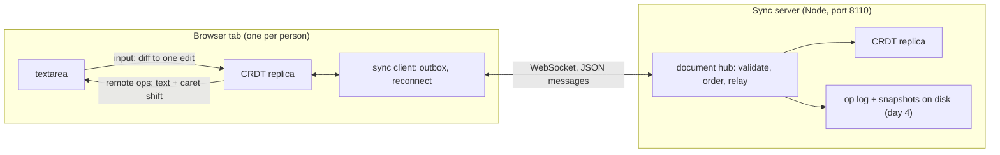

# Coedit design

Coedit is a plain-text editor that several people can edit at once, each in their own browser tab. An edit shows up
for everyone else about one network round trip later, and anyone can keep editing while offline; their edits merge
when they reconnect. Nothing decides the merge centrally: every tab and the server hold a copy (a _replica_) of one
data structure, a sequence CRDT, and apply the same operations to it. The operations commute, so replicas that have
received the same operations show the same text, whatever order the operations arrived in.

This file is the specification for all five days. Sections marked with a day are built that day.

## Goals and non-goals

Goals:

- **Convergence** (strong eventual consistency): two replicas that have applied the same set of operations hold the
  same document, whatever the order of delivery and however many times an operation was delivered.
- **Intention preservation for inserts**: a character typed at a position appears there, and two people typing at
  the same spot at the same time get their runs one after the other, not interleaved character by character.
- **Offline editing**: a client keeps editing without the server and catches up when it returns.
- **Presence**: everyone sees everyone else's cursor, and a cursor stays next to the same text when others edit.

Not goals: rich text, undo across users, accounts and access control (the server listens on 127.0.0.1 by default
and trusts its clients to be who they say; see "Limitations" in the README), and more than one server process.

## Architecture



Three npm workspaces:

| Package          | Runs in         | Holds                                                                      |
| ---------------- | --------------- | -------------------------------------------------------------------------- |
| `@coedit/crdt`   | browser, Node   | the CRDT, the wire format of operations and protocol messages (`protocol`) |
| `@coedit/server` | Node            | the HTTP and WebSocket server, document hubs, persistence                  |
| `@coedit/client` | browser (React) | the editor: textarea, edit mapping, sync client, presence                  |

The CRDT package has no dependencies and may not import Node's modules (ESLint enforces it), so the browser and the
server run the same code.

## The CRDT: RGA (day 2)

Coedit uses RGA, the Replicated Growable Array (Roh et al., 2011), in its usual modern form: each element records
the element it was inserted after, and one ordering rule places concurrent inserts.

### Elements and ids

The document is a sequence of _elements_. Each element is one Unicode code point, an id, and a deleted flag.

- **Why code points.** Browsers index text in UTF-16 code units, where most emoji take two. If an element were a
  code unit, a concurrent edit could land between the two halves of a pair and leave a lone surrogate in everyone's
  document. Code points can't be split that way. Grapheme clusters (an emoji with skin tone, a letter with a
  combining accent) still can: two concurrent edits can separate a base from its modifier. That's accepted; the
  result is still valid Unicode and the same on every replica.
- **An id** is a pair `(counter, replica)`. `replica` is a string the replica picks for itself at start (16 random
  bytes, base64url); `counter` is a positive integer from the replica's Lamport clock. A replica never reuses a
  counter, and two replicas never share a replica id, so ids are unique. A tab that reloads without its state is a
  new replica with a new id.
- **The Lamport clock.** Each replica keeps `clock`, the largest counter it has seen. A local insert takes
  `clock + 1`; receiving an element with counter `c` sets `clock = max(clock, c)`. So an element inserted by someone
  who had already seen element `e` has a larger counter than `e`. The clock also covers inserts still waiting for
  their origin and the ids a delete names under this replica's own id, so its new ids never equal an id it holds,
  waits for, or has seen deleted, even when a buggy peer used this replica's id. A delete of other replicas' ids
  doesn't move it: it makes no element that could be an origin, and one naming 2^53 - 1 would otherwise stop every
  insert. At 2^53 - 1 the clock has run out: edits that need ids are refused (deletes still work).
- **The order of ids**: by counter, then by replica string (code unit order). It's a total order.

### Insert

An insert names its _origin_: the id of the element just left of the cursor when it was typed, or `HEAD` at the very
start. To integrate an element `x` with origin `o`, a replica starts just after `o` and moves right past every element
whose id is greater than `x`'s, then places `x` before the first element whose id is smaller (or at the end).

Why that is right, and the same everywhere: think of each element as a child of its origin, with children sorted by
id from largest to smallest; the document is this tree read in preorder. `x` belongs among `o`'s children, after the
subtrees of every child larger than it. Each element's id is larger than its origin's (the Lamport property above),
so a whole subtree of a child larger than `x` is larger than `x` and gets skipped, and the scan stops at the first
smaller child or at the first element after `o`'s subtree, which is always smaller than `x` too. The position depends
only on the set of elements present, not on the order they arrived in, so every replica builds the same sequence.

That proof needs every element's counter to be larger than its origin's. A replica that received an insert breaking
that rule would place it differently from the others, so it is refused when decoded (it can only come from a buggy
or tampered client).

Runs of text are one operation: inserting `"abc"` with first id `(c, r)` makes elements `(c, r)`, `(c+1, r)`,
`(c+2, r)`, each the origin of the next. A run's elements are a chain in the tree, so two people typing at the same
spot at the same time get their runs whole, one before the other, never interleaved.

What RGA does not prevent: text typed _backwards_ at one spot (each character inserted before the previous one, as
when pressing Home before every key) has the same origin for every character, and two such concurrent runs do
interleave. Fugue (Weidner and Kleppmann, 2023) fixes that with a second, right-hand origin; it's out of scope here,
and a test will pin the behaviour so it's documented, not discovered.

### Delete

Deleting marks elements as deleted (a _tombstone_). A tombstone stays in the sequence because later inserts may name
it as their origin, including inserts from replicas that never saw the delete. A delete operation lists the ids it
deletes, as spans of consecutive counters of one replica, since a deleted range of text is usually a few runs.

### Order of delivery, duplicates, and conflicts

- **Any order.** An insert depends on its origin and a delete on its targets. A replica that receives an operation
  before its dependencies keeps it in a pending set and applies it when they arrive. So the network only has to
  deliver everything eventually; it need not deliver in causal order. The day-2 tests deliver in random orders.
- **Duplicates.** An insert that arrives again is a no-op, and deleting a tombstone is a no-op, so redelivery is
  harmless (the sync client resends after reconnecting, and the server echoes, below).
- **The same id with different content** (another character or another origin) would split replicas apart for good,
  so it's an error, not a duplicate: the operation is refused. A run is created whole by one replica and its counters
  are never reused, so a resent run is either entirely known (a duplicate) or entirely new; a run that is partly known
  can only come from a reused counter, and is refused too. Precisely: an insert is a duplicate only if it is the same
  run, with the same first id, origin and text; any other insert touching a known id is refused (`ConflictError`),
  waiting runs included. Matching whole runs, not elements, makes _whether_ two inserts conflict independent of
  their order (element by element, a run made of the tail of a known run would pass as a duplicate one way round and
  conflict the other). _Which_ of a conflicting pair is kept still depends on which arrived first, so replicas that
  receive such a pair in different orders keep different ones; in Coedit's topology the server decides, by refusing
  the second, and clients only ever see its choice.
- **Deletes ahead of their inserts.** A delete applies at once to what is here; ids not here yet are remembered, and
  their elements arrive as tombstones. A delete of an element that is itself waiting for its origin marks it, so it
  is placed as a tombstone. `pending` counts the distinct operations still waiting (each delete naming a missing id
  waits for it, not only the first), so like the state it depends only on which operations arrived.
- **In Coedit's own topology delivery is causal anyway.** A client sends its operations in order on one WebSocket and
  references only elements it got from the server or made itself, so the server always has an operation's
  dependencies when it arrives, and refuses one whose dependencies it lacks (it never holds pending operations). The
  server's log is therefore in causal order, and so is every client's view of it. The pending set is for everything
  else: tests that deliver in any order, a future peer-to-peer mode, and not having to trust that reasoning.

### Positions and ids

The editor talks in visible positions; the CRDT in ids. A local edit `(index, deleteCount, text)` becomes a delete of
the `deleteCount` visible elements from `index` and an insert whose origin is the visible element at `index - 1` (or
`HEAD`). Applying a remote operation reports the visible change it made (inserted `n` at `i`, deleted `n` at `i`), so
the client can patch the textarea and shift the caret instead of re-rendering everything.

The first implementation keeps the elements in one array and finds positions by scanning: O(n) per operation, simple
and easy to test. Day 4 measures it; if it's too slow at realistic sizes, an order-statistics tree replaces the array
behind the same interface.

### The interface (day 2)

```ts
class Rga {
  // clock: where the Lamport clock starts (tests). capacity: see below (default and most 2^24 - 1).
  constructor(replica: string, options?: { clock?: number; capacity?: number });
  text(): string; // the visible text
  readonly length: number; // visible code points
  readonly clock: number; // the largest counter made or seen
  /**
   * A local edit, applied at once; returns the operations to send: deletes, then inserts. One insert carries at
   * most 10,000 code points and one delete 1,000 spans, so a larger edit becomes several (each insert after the
   * last). Throws RangeError for a position outside the text, a lone surrogate, or a clock that has run out.
   */
  edit(index: number, deleteCount: number, text: string): Op[];
  /**
   * Applies an operation from anyone (an echo of this replica's own included). Returns the visible changes, in
   * order: none for a duplicate or for an operation still waiting on a dependency, and, when an operation completes
   * the dependencies of waiting ones, theirs too. Throws ProtocolError for an operation the wire format refuses,
   * ConflictError for an id reused with different content, and RangeError for one that would pass the capacity;
   * whichever it is, nothing changes.
   */
  apply(op: Op): Change[];
  /** For presence: the id of the visible element before `index` (null at 0), and where a position is now. */
  idBefore(index: number): Id | null;
  indexAfter(id: Id | null): number | undefined; // undefined: that element isn't placed here
  readonly pending: number; // operations waiting on a dependency
  state(): string; // the whole state, canonically: elements, tombstones, waiting runs, ids deleted ahead
}
type Change =
  | { type: 'insert'; index: number; text: string }
  | { type: 'delete'; index: number; count: number };
```

Indices and counts are in code points; the client converts to UTF-16. A delete reports one change per stretch of
consecutive visible elements, each index shifted left by the stretches before it, so the changes apply one after
another. An operation `apply` refuses leaves the replica exactly as it was, clock included, and so does an `edit`
that throws. That includes running out of room: a V8 Map holds at most 2^24 entries, so a replica holds at most
2^24 - 1 elements (tombstones and waiting ones included), as many ids deleted ahead, and as many waiting deletes (its
_capacity_), and refuses up front an operation that would hold more, rather than have a Map refuse it halfway
(review 2 of day 2 found two valid deletes that did). Replicas holding different things may then disagree about
whether to accept an operation, like any resource limit; the server (day 3) refuses such operations first.

The convergence tests drive it through the simulator's `Subject` interface (`edit` and `apply`), compare `text()`
across replicas, and also require that every replica's internal sequence (ids, tombstones included) is identical, not
only the text: two replicas whose texts agree but whose tombstones sit in different places would diverge on the
next insert.

## Testing convergence

Convergence is a property over every possible interleaving, so it's tested with generated schedules (fast-check),
in a deterministic network simulator (`packages/crdt/test/harness/`, day 1):

- **Replicas and a message pool.** Each step is one of: a local edit at some replica (random position, length and
  text, resolved against that replica's current document), delivering one in-flight message to one replica, or
  delivering a copy of an already-delivered message again. Not delivering for a while is a partition.
- **The final check.** After the generated steps, every message is delivered everywhere in a random order, and every
  replica must show the same text. A failing schedule shrinks to a minimal one, printed as the steps.
- **Text and state.** The text must agree, and so must each replica's whole internal state when the replica can write
  it out canonically (`state()`): two replicas with the same text but tombstones in different places would disagree
  on the next edit.
- **The harness tests itself in both directions.** A correct toy CRDT must pass. Four wrong ones must _fail_, each
  only when the network freedom (or check) that exposes it is on: one that applies inserts by index (diverges under
  concurrency), one that isn't idempotent (breaks on redelivery or echo), one that assumes causal delivery (breaks on
  reordering), and one that removes a locally deleted character instead of keeping a tombstone (its texts agree and
  only the state check sees it; with redelivery its texts diverge too). If the harness couldn't catch those, a passing
  RGA would prove nothing.
- **Day 2 adds** (built: the `rga` test files in `packages/crdt/test/`), for RGA: convergence over 2 to 5 replicas,
  comparing `state()` (ids and tombstones) as well as text; agreement with a plain string model when edits are made
  one at a time (`localModel`); runs typed concurrently at one spot never interleave, and the backward-typing
  interleave pinned as documented; refusals for each kind of bad operation. Also, from day 1's review:
  - **The id order directly**, against UTF-16 code-unit order, on the simulator's replica names (`m Z b B mm a_`,
    whose code-unit, locale and creation orders all differ): within one process the convergence check can't catch a
    comparator that is wrong only across machines, such as `localeCompare`.
  - **Large counters**: replicas whose clocks start near 2^31 and near 2^53 - 1 - 10,000, since generated schedules
    keep counters under about 100.
  - The pending set: operations whose dependency never arrives stay pending and count in `pending`; nothing else
    changes. Checked against a model of which operations can apply, over editing sessions with operations withheld.
  - **What a replica holds depends only on which operations reached it**: the same subset in two generated orders,
    with duplicates, and in causal order gives the same `state()` and `pending`.
  - The visible changes: on every delivery, `apply`'s changes replayed on the text before must give the text after.

## The wire format (day 1)

Operations and messages are JSON. `packages/crdt/src/protocol.ts` defines the types and a strict decoder: anything not
exactly as specified is refused with a reason, because a malformed operation accepted by one replica and refused by
another is a divergence.

```text
Id      = { "replica": string, "counter": integer }
Insert  = { "type": "insert", "id": Id, "origin": Id | null, "text": string }
Delete  = { "type": "delete", "spans": [ { "replica": string, "counter": integer, "length": integer } ] }
```

- `replica`: 1 to 32 characters of `A-Z a-z 0-9 _ -` (a base64url-encoded 16-byte id is 22).
- `counter`: an integer from 1 to 2^53 - 1 (JavaScript's safe range), written without a fraction or exponent.
- `origin: null` means `HEAD`. An insert's counter must be larger than its origin's.
- `text`: 1 to 10,000 code points, well-formed UTF-16 (JSON can carry a lone surrogate as `"\ud800"`; that's
  refused). A run's last counter, `counter + length - 1`, must stay in the safe range.
- `spans`: 1 to 1,000 spans, each `length` 1 to 10,000, last counter in the safe range.
- An `ops` message carries 1 to 1,000 operations; an `error`'s message is at most 1,000 code points. The 1 MiB limit on
  a whole message is the WebSocket server's (day 3), checked before decoding.
- Unknown and missing keys are refused; key order and whitespace don't matter to the decoder, and the encoder always
  writes one canonical text (keys in the order above, no whitespace).
- The decoder reads JSON with its own strict reader (`packages/crdt/src/json.ts`), not `JSON.parse`, which keeps the
  last of duplicate keys, returns lone surrogates, rounds what it can't hold (`9007199254740993`, `1e400`) and keeps `-0`.
  The reader refuses all of those, plus fractions and exponents (every number here is an integer), a byte order mark
  and nesting deeper than 32. Where it accepts a text it gives the same value as `JSON.parse`.
- The encoder runs the same checks before writing, so a replica can't send what the others would refuse.

## The sync protocol (day 3)

One WebSocket per client and document, at `ws://<host>:8110/sync`, carrying JSON text messages, each an object with a
`type`. The decoder above checks every message the server receives and every message a client receives.

Client to server:

| Message    | Fields                                 | Meaning                                                         |
| ---------- | -------------------------------------- | --------------------------------------------------------------- |
| `hello`    | `protocol`, `doc`, `replica`, `have`   | first message: join document `doc`; I have the log up to `have` |
| `ops`      | `ops`                                  | my local operations, in the order I made them                   |
| `presence` | `cursor`: `{ anchor, head }` or `null` | my selection, as positions after element ids                    |

Server to client:

| Message    | Fields                   | Meaning                                                            |
| ---------- | ------------------------ | ------------------------------------------------------------------ |
| `welcome`  | `protocol`, `doc`, `seq` | joined; the log currently ends at `seq`                            |
| `ops`      | `from`, `ops`            | log entries `from`, `from + 1`, ... (missed ones first, then live) |
| `presence` | `replica`, `cursor`      | someone's selection (`cursor: null`: they left or hid it)          |
| `error`    | `code`, `message`        | refused; the server closes the connection after it                 |

- **The server orders.** It numbers every operation it accepts 1, 2, 3, ... in its log and relays each one to every
  client of the document, the sender included. The echo is the acknowledgement: a client drops an operation from its
  outbox when it comes back with a sequence number, and the CRDT ignores the duplicate. It costs the sender a copy of
  its own edits; in exchange every client sees the same numbered log, and `have` means the same thing for all.
- **Reconnect.** The client remembers the last sequence number it applied. On reconnect it sends `hello` with it,
  receives what it missed, then resends its whole outbox. Both go in as many messages as it takes at 1,000
  operations each. The server applies operations to its own replica first, so
  a resent operation it already has is recognized and not logged twice.
- **The server validates by applying.** An operation the server's replica refuses (bad shape, same id with different
  content, counter not above its origin's) gets an `error` and the connection is closed; nothing is relayed.
- **Presence** positions are ids, not indices ("after element X", or `HEAD`), so a cursor stays by its text when
  others edit before it. Presence is never logged; a client resends it on reconnect and the server sends
  `cursor: null` for a client that disconnects.
- **Limits**: a message is at most 1 MiB, a document name 1 to 64 characters of `A-Z a-z 0-9 _ -`.

## The client (day 3)

A `<textarea>`, not `contenteditable`: plain text with a selection API that behaves the same in every browser.

- **Input to an edit.** On each input event the client compares the text before and after and finds the one changed
  span, in code points (`packages/client/src/edit.ts`, day 1). The caret decides where it is: after typing, pasting,
  deleting or replacing a selection the browser leaves the caret right after the inserted text, so the common suffix
  is taken first and may not reach left of the caret, then the common prefix of what remains. Typing `a` into `aa`
  could have inserted at any of three places, and the caret says which. The edit found can be bigger than the
  smallest one, when it's what was typed: replacing "orld" by "and" is a delete of 4 and an insert of 3, although
  keeping the old "d" would be smaller; which element is kept decides where a concurrent insert next to it lands.
- **Remote changes.** A remote operation's visible change is applied to the text, and the caret and selection move
  with it: an insert before the caret shifts it right, a delete around it pulls it to the delete's start.
- **IME composition** (typing Chinese, Japanese, accented letters by dead keys): while a composition is open the
  browser owns the textarea, so remote changes wait until it ends.
- **Offline**: the outbox lives in memory, so it survives a dropped connection but not a closed tab.

## Persistence and tombstones (day 4)

- **Op log and snapshots.** Each document has a directory: `ops.log` (one JSON line per accepted operation, with its
  sequence number, appended before the operation is relayed) and snapshots (the whole CRDT state with its sequence
  number). On start the server loads the newest snapshot and replays the log after it; a torn last line from a crash
  is dropped. A client whose `have` is older than the oldest kept log entry gets the snapshot instead.
- **Tombstone garbage collection.** Tombstones grow without bound. One can be removed only when no operation that may
  still arrive names it, and an offline client can return any time with operations naming anything it saw. Day 4
  collects only what the server can prove: tombstones deleted before every connected replica's `have` and older than
  a retention window; a client returning after that window with operations that name a collected element is resynced
  from a snapshot, and its unsent edits are re-applied by position (its text survives, its exact placement may not).
  A tombstone's character isn't needed at all, only its id, so that much can go immediately.
- **Measured**: operations per second (local typing, remote integration, a large paste), document size per visible
  character as edits accumulate, and the tombstone share, over a synthetic editing session and, if its license
  allows, a published editing trace.
- **End to end**: Playwright with two browser contexts editing one document at once, offline and back.

## Days

| Day | Delivers                                                                                                                                |
| --- | --------------------------------------------------------------------------------------------------------------------------------------- |
| 1   | this design; workspaces, CI; the wire format and its strict decoder; the network simulator and its self-test; the client's edit mapping |
| 2   | the CRDT (ids, Lamport clock, insert, delete, tombstones, pending operations); convergence properties                                   |
| 3   | the sync server and React client; presence; offline buffering and reconnect                                                             |
| 4   | persistence (snapshots + op log); tombstone GC; Playwright e2e with two browsers; ops/sec, document growth                              |
| 5   | README with results, WALKTHROUGH.md, v1.0.0                                                                                             |

## Decisions

- **A CRDT, not operational transformation.** OT needs a server to transform concurrent edits against each other, and
  a correct transform for text plus offline editing is notoriously hard to get right. A CRDT makes every replica
  equal; the server only stores and relays (and checks).
- **RGA, not YATA (Yjs) or Fugue.** RGA is one ordering rule with a short proof, which matters for a project meant to
  be explained end to end. Its known weakness (backward typing interleaves) is documented above.
- **Written by hand, not Yjs or Automerge.** Being hand-written is the point of the project.
- **JSON text messages.** Easy to read in a browser's network panel and to test; a binary encoding would be smaller,
  and day 4's measurements will say whether it matters.
- **Node's own test runner and type stripping.** Node runs the TypeScript directly (types are erased, nothing is
  compiled), so the server and the tests need no build step; `tsc` only checks types. That rules out TypeScript-only
  runtime syntax (enums, parameter properties), which `erasableSyntaxOnly` enforces.
