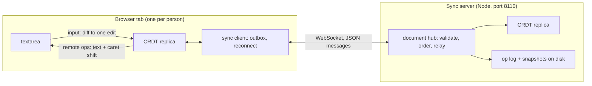

# Coedit design

Coedit is a plain-text editor that several people can edit at once, each in their own browser tab. An edit shows up
for everyone else about one network round trip later, and anyone can keep editing while offline; their edits merge
when they reconnect. Nothing decides the merge centrally: every tab and the server hold a copy (a _replica_) of one
data structure, a sequence CRDT, and apply the same operations to it. The operations commute, so replicas that have
received the same operations show the same text, whatever order the operations arrived in.

This file is the specification for all five days. Sections marked with a day are built that day.

## Goals and non-goals

Goals:

- **Convergence** (strong eventual consistency): two replicas that have applied the same set of operations hold the
  same document, whatever the order of delivery and however many times an operation was delivered.
- **Intention preservation for inserts**: a character typed at a position appears there, and two people typing at
  the same spot at the same time get their runs one after the other, not interleaved character by character.
- **Offline editing**: a client keeps editing without the server and catches up when it returns.
- **Presence**: everyone sees everyone else's cursor, and a cursor stays next to the same text when others edit.

Not goals: rich text, undo across users, accounts and access control (the server listens on 127.0.0.1 by default
and trusts its clients to be who they say; see "Limitations" in the README), and more than one server process.

## Architecture



Three npm workspaces:

| Package          | Runs in         | Holds                                                                      |
| ---------------- | --------------- | -------------------------------------------------------------------------- |
| `@coedit/crdt`   | browser, Node   | the CRDT, the wire format of operations and protocol messages (`protocol`) |
| `@coedit/server` | Node            | the HTTP and WebSocket server, document hubs, persistence                  |
| `@coedit/client` | browser (React) | the editor: textarea, edit mapping, sync client, presence                  |

The CRDT package has no dependencies and may not import Node's modules (ESLint enforces it), so the browser and the
server run the same code.

## The CRDT: RGA (day 2)

Coedit uses RGA, the Replicated Growable Array (Roh et al., 2011), in its usual modern form: each element records
the element it was inserted after, and one ordering rule places concurrent inserts.

### Elements and ids

The document is a sequence of _elements_. Each element is one Unicode code point, an id, and a deleted flag.

- **Why code points.** Browsers index text in UTF-16 code units, where most emoji take two. If an element were a
  code unit, a concurrent edit could land between the two halves of a pair and leave a lone surrogate in everyone's
  document. Code points can't be split that way. Grapheme clusters (an emoji with skin tone, a letter with a
  combining accent) still can: two concurrent edits can separate a base from its modifier. That's accepted; the
  result is still valid Unicode and the same on every replica.
- **An id** is a pair `(counter, replica)`. `replica` is a string the replica picks for itself at start (16 random
  bytes, base64url); `counter` is a positive integer from the replica's Lamport clock. A replica never reuses a
  counter, and two replicas never share a replica id, so ids are unique. A tab that reloads without its state is a
  new replica with a new id.
- **The Lamport clock.** Each replica keeps `clock`, the largest counter among its own ids and the ids it has
  received in inserts (and, below, some deletes). A local insert takes
  `clock + 1`; receiving an element with counter `c` sets `clock = max(clock, c)`. So an element inserted by someone
  who had already seen element `e` has a larger counter than `e`. The clock also covers inserts still waiting for
  their origin and the ids a delete names under this replica's own id, so its new ids never equal an id it holds,
  waits for, or has seen deleted, even when a buggy peer used this replica's id. A delete of other replicas' ids
  doesn't move it: it makes no element that could be an origin, and one naming 2^53 - 1 would otherwise stop every
  insert. At 2^53 - 1 the clock has run out: edits that need ids are refused (deletes still work).
- **The order of ids**: by counter, then by replica string (code unit order). It's a total order.

### Insert

An insert names its _origin_: the id of the element just left of the cursor when it was typed, or `HEAD` at the very
start. To integrate an element `x` with origin `o`, a replica starts just after `o` and moves right past every element
whose id is greater than `x`'s, then places `x` before the first element whose id is smaller (or at the end).

Why that is right, and the same everywhere: think of each element as a child of its origin, with children sorted by
id from largest to smallest; the document is this tree read in preorder. `x` belongs among `o`'s children, after the
subtrees of every child larger than it. Each element's id is larger than its origin's (the Lamport property above),
so a whole subtree of a child larger than `x` is larger than `x` and gets skipped, and the scan stops at the first
smaller child or at the first element after `o`'s subtree, which is always smaller than `x` too. The position depends
only on the set of elements present, not on the order they arrived in, so every replica builds the same sequence.

That proof needs every element's counter to be larger than its origin's. A replica that received an insert breaking
that rule would place it differently from the others, so it is refused when decoded (it can only come from a buggy
or tampered client).

Runs of text are one operation: inserting `"abc"` with first id `(c, r)` makes elements `(c, r)`, `(c+1, r)`,
`(c+2, r)`, each the origin of the next. A run's elements are a chain in the tree, so two people typing at the same
spot at the same time get their runs whole, one before the other, never interleaved.

What RGA does not prevent: text typed _backwards_ at one spot (each character inserted before the previous one, as
when pressing Home before every key) has the same origin for every character, and two such concurrent runs do
interleave. Fugue (Weidner and Kleppmann, 2023) fixes that with a second, right-hand origin; it's out of scope here,
and a test will pin the behaviour so it's documented, not discovered.

### Delete

Deleting marks elements as deleted (a _tombstone_). A tombstone stays in the sequence because later inserts may name
it as their origin, including inserts from replicas that never saw the delete. A delete operation lists the ids it
deletes, as spans of consecutive counters of one replica, since a deleted range of text is usually a few runs.

### Order of delivery, duplicates, and conflicts

- **Any order.** An insert depends on its origin and a delete on its targets. A replica that receives an operation
  before its dependencies keeps it in a pending set and applies it when they arrive. So the network only has to
  deliver everything eventually; it need not deliver in causal order. The day-2 tests deliver in random orders.
- **Duplicates.** An insert that arrives again is a no-op, and deleting a tombstone is a no-op, so redelivery is
  harmless (the sync client resends after reconnecting, and the server echoes, below).
- **The same id with different content** (another character or another origin) would split replicas apart for good,
  so it's an error, not a duplicate: the operation is refused. A run is created whole by one replica and its counters
  are never reused, so a resent run is either entirely known (a duplicate) or entirely new; a run that is partly known
  can only come from a reused counter, and is refused too. Precisely: an insert is a duplicate only if it is the same
  run, with the same first id, origin and text; any other insert touching a known id is refused (`ConflictError`),
  waiting runs included. Matching whole runs, not elements, makes _whether_ two inserts conflict independent of
  their order (element by element, a run made of the tail of a known run would pass as a duplicate one way round and
  conflict the other). _Which_ of a conflicting pair is kept still depends on which arrived first, so replicas that
  receive such a pair in different orders keep different ones; in Coedit's topology the server decides, by refusing
  the second, and clients only ever see its choice.
- **Deletes ahead of their inserts.** A delete applies at once to what is here; ids not here yet are remembered, and
  their elements arrive as tombstones. A delete of an element that is itself waiting for its origin marks it, so it
  is placed as a tombstone. `pending` counts the distinct operations still waiting (each delete naming a missing id
  waits for it, not only the first), so like the state it depends only on which operations arrived.
- **In Coedit's own topology delivery is causal anyway.** A client sends its operations in order on one WebSocket and
  references only elements it got from the server or made itself, so the server always has an operation's
  dependencies when it arrives, and refuses one whose dependencies it lacks (it never holds pending operations). The
  server's log is therefore in causal order, and so is every client's view of it. The pending set is for everything
  else: tests that deliver in any order, a future peer-to-peer mode, and not having to trust that reasoning.

### Positions and ids

The editor talks in visible positions; the CRDT in ids. A local edit `(index, deleteCount, text)` becomes a delete of
the `deleteCount` visible elements from `index` and an insert whose origin is the visible element at `index - 1` (or
`HEAD`). Applying a remote operation reports the visible change it made (inserted `n` at `i`, deleted `n` at `i`), so
the client can patch the textarea and shift the caret instead of re-rendering everything.

The first implementation kept the elements in one array and found positions by scanning: O(n) per operation, simple
and easy to test. Day 4 measured it (README "Results (day 4)"): local edits fell from about 50,000 a second at 11,000
elements to about 1,460 at 369,000, and loading a document of 100,000 one-character entries took 6 to 7 s. Now the
elements are in blocks (512 by default; one past 1,024 is split), each counting its visible elements, and each element
knows its block: a visible index is found by skipping whole blocks by their counts, an element's position is its
block's place plus an `indexOf` inside it, and a delete's pass skips blocks holding none of its targets. About
n / 512 + 512 steps instead of n: 256,670 local edits a second at 369,000 elements, and the same document loads in
under half a second. `rga-blocks.test.ts` runs the same sessions with blocks of 1 to 3 elements and with one block
that never splits (the old array) and requires every output to match. A balanced tree would make it logarithmic; at
these sizes the blocks are flat.

### The interface (day 2)

```ts
class Rga {
  // clock: where the Lamport clock starts (tests). capacity: see below (default and most 2^23 - 1).
  constructor(replica: string, options?: { clock?: number; capacity?: number });
  text(): string; // the visible text
  readonly length: number; // visible code points
  readonly clock: number; // the largest counter of its own and received inserts, and of its own ids deleted
  /**
   * A local edit, applied at once; returns the operations to send: deletes, then inserts. One insert carries at
   * most 10,000 code points and one delete 1,000 spans, so a larger edit becomes several (each insert after the
   * last). Throws RangeError for a position outside the text, a lone surrogate, or a clock that has run out.
   */
  edit(index: number, deleteCount: number, text: string): Op[];
  /**
   * Applies an operation from anyone (an echo of this replica's own included). Returns the visible changes, in
   * order: none for a duplicate or for an operation still waiting on a dependency, and, when an operation completes
   * the dependencies of waiting ones, theirs too. Throws ProtocolError for an operation the wire format refuses,
   * ConflictError for an id reused with different content, and RangeError for one that would pass the capacity;
   * whichever it is, nothing changes.
   */
  apply(op: Op): Change[];
  /** For presence: the id of the visible element before `index` (null at 0), and where a position is now. */
  idBefore(index: number): Id | null;
  indexAfter(id: Id | null): number | undefined; // undefined: that element isn't placed here
  readonly pending: number; // operations waiting on a dependency
  state(): string; // the whole state, canonically: elements, tombstones, waiting runs, ids deleted ahead
}
type Change =
  | { type: 'insert'; index: number; text: string }
  | { type: 'delete'; index: number; count: number };
```

Indices and counts are in code points; the client converts to UTF-16. A delete reports one change per stretch of
consecutive visible elements, each index shifted left by the stretches before it, so the changes apply one after
another. An operation `apply` refuses leaves the replica exactly as it was, clock included, and so does an `edit`
that throws. That includes running out of room: a V8 Map's table holds at most 2^24 entries, deleted ones included
until it rehashes, and a full table can only compact (rather than grow, which fails) when at least half of it is
deleted entries. So a replica holds at most 2^23 - 1 elements (tombstones and waiting ones included), as many ids
deleted ahead, and as many waiting deletes (its _capacity_), and refuses up front an operation that would hold more,
rather than have a Map refuse it halfway (reviews 2 and 3 of day 2 found valid deletes that did, at 2^24 and then at
about 2^23 live entries). Replicas holding different things may then disagree about
whether to accept an operation, like any resource limit; the server (day 3) refuses such operations first.

The convergence tests drive it through the simulator's `Subject` interface (`edit` and `apply`), compare `text()`
across replicas, and also require that every replica's internal sequence (ids, tombstones included) is identical, not
only the text: two replicas whose texts agree but whose tombstones sit in different places would diverge on the
next insert.

## Testing convergence

Convergence is a property over every possible interleaving, so it's tested with generated schedules (fast-check),
in a deterministic network simulator (`packages/crdt/test/harness/`, day 1):

- **Replicas and a message pool.** Each step is one of: a local edit at some replica (random position, length and
  text, resolved against that replica's current document), delivering one in-flight message to one replica, or
  delivering a copy of an already-delivered message again. Not delivering for a while is a partition.
- **The final check.** After the generated steps, every message is delivered everywhere in a random order, and every
  replica must show the same text. A failing schedule shrinks to a minimal one, printed as the steps.
- **Text and state.** The text must agree, and so must each replica's whole internal state when the replica can write
  it out canonically (`state()`): two replicas with the same text but tombstones in different places would disagree
  on the next edit.
- **The harness tests itself in both directions.** A correct toy CRDT must pass. Four wrong ones must _fail_, each
  only when the network freedom (or check) that exposes it is on: one that applies inserts by index (diverges under
  concurrency), one that isn't idempotent (breaks on redelivery or echo), one that assumes causal delivery (breaks on
  reordering), and one that removes a locally deleted character instead of keeping a tombstone (its texts agree and
  only the state check sees it; with redelivery its texts diverge too). If the harness couldn't catch those, a passing
  RGA would prove nothing.
- **Day 2 adds** (built: the `rga` test files in `packages/crdt/test/`), for RGA: convergence over 2 to 5 replicas,
  comparing `state()` (ids and tombstones) as well as text; agreement with a plain string model when edits are made
  one at a time (`localModel`); runs typed concurrently at one spot never interleave, and the backward-typing
  interleave pinned as documented; refusals for each kind of bad operation. Also, from day 1's review:
  - **The id order directly**, against UTF-16 code-unit order, on the simulator's replica names (`m Z b B mm a_`,
    whose code-unit, locale and creation orders all differ): within one process the convergence check can't catch a
    comparator that is wrong only across machines, such as `localeCompare`.
  - **Large counters**: replicas whose clocks start near 2^31 and near 2^53 - 1 - 10,000, since generated schedules
    keep counters under about 100.
  - The pending set: operations whose dependency never arrives stay pending and count in `pending`; nothing else
    changes. Checked against a model of which operations can apply, over editing sessions with operations withheld.
  - **What a replica holds depends only on which operations reached it**: the same subset in two generated orders,
    with duplicates, and in causal order gives the same `state()` and `pending`.
  - The visible changes: on every delivery, `apply`'s changes replayed on the text before must give the text after.

## The wire format (day 1)

Operations and messages are JSON. `packages/crdt/src/protocol.ts` defines the types and a strict decoder: anything not
exactly as specified is refused with a reason, because a malformed operation accepted by one replica and refused by
another is a divergence.

```text
Id      = { "replica": string, "counter": integer }
Insert  = { "type": "insert", "id": Id, "origin": Id | null, "text": string }
Delete  = { "type": "delete", "spans": [ { "replica": string, "counter": integer, "length": integer } ] }
```

- `replica`: 1 to 32 characters of `A-Z a-z 0-9 _ -` (a base64url-encoded 16-byte id is 22).
- `counter`: an integer from 1 to 2^53 - 1 (JavaScript's safe range), written without a fraction or exponent.
- `origin: null` means `HEAD`. An insert's counter must be larger than its origin's.
- `text`: 1 to 10,000 code points, well-formed UTF-16 (JSON can carry a lone surrogate as `"\ud800"`; that's
  refused). A run's last counter, `counter + length - 1`, must stay in the safe range.
- `spans`: 1 to 1,000 spans, each `length` 1 to 10,000, last counter in the safe range.
- An `ops` message carries 1 to 1,000 operations; an `error`'s message is at most 1,000 code points. The 1 MiB limit on
  a whole message is the WebSocket server's (day 3), checked before decoding.
- Unknown and missing keys are refused; key order and whitespace don't matter to the decoder, and the encoder always
  writes one canonical text (keys in the order above, no whitespace).
- The decoder reads JSON with its own strict reader (`packages/crdt/src/json.ts`), not `JSON.parse`, which keeps the
  last of duplicate keys, returns lone surrogates, rounds what it can't hold (`9007199254740993`, `1e400`) and keeps `-0`.
  The reader refuses all of those, plus fractions and exponents (every number here is an integer), a byte order mark
  and nesting deeper than 32. Where it accepts a text it gives the same value as `JSON.parse`.
- The encoder runs the same checks before writing, so a replica can't send what the others would refuse.

## The sync protocol (day 3)

One WebSocket per client and document, at `ws://<host>:8110/sync`, carrying JSON text messages, each an object with a
`type`. The decoder above checks every message the server receives and every message a client receives.

Client to server:

| Message    | Fields                                 | Meaning                                                         |
| ---------- | -------------------------------------- | --------------------------------------------------------------- |
| `hello`    | `protocol`, `doc`, `replica`, `have`   | first message: join document `doc`; I have the log up to `have` |
| `ops`      | `ops`                                  | my local operations, in the order I made them                   |
| `presence` | `cursor`: `{ anchor, head }` or `null` | my selection, as positions after element ids                    |

Server to client:

| Message     | Fields                   | Meaning                                                            |
| ----------- | ------------------------ | ------------------------------------------------------------------ |
| `welcome`   | `protocol`, `doc`, `seq` | joined; the log currently ends at `seq`                            |
| `ops`       | `from`, `ops`            | log entries `from`, `from + 1`, ... (missed ones first, then live) |
| `snapshot`  | `seq`, `ops`, `last`     | day 4: the document after entry `seq`, for a client too far behind |
| `collected` | `spans`                  | day 4: ids the document has collected, before a snapshot's parts   |
| `presence`  | `replica`, `cursor`      | someone's selection (`cursor: null`: they left or hid it)          |
| `error`     | `code`, `message`        | refused; the server closes the connection after it                 |

Error codes: `malformed`, `unsupported-protocol`, `unexpected-message`, `refused-op`, `too-large` (the document is
full), `ahead-of-server` (below), `server-error`, the only one a client retries after as is, and (day 4) `resync`, after
which it rejoins asking for a snapshot ("Tombstones").

- **The server orders.** It numbers every operation it accepts 1, 2, 3, ... in its log and relays each one to every
  client of the document, the sender included. The echo is the acknowledgement: a client drops an operation from its
  outbox when it comes back with a sequence number (or, from day 4, when a snapshot it receives holds it: "Persistence
  (day 4)"), and the CRDT ignores the duplicate. It costs the sender a copy of
  its own edits; in exchange every client sees the same numbered log, and `have` means the same thing for all.
- **Reconnect.** The client remembers the last sequence number it applied. On reconnect it sends `hello` with it,
  receives what it missed (up to the `seq` in `welcome`), and only then resends its whole outbox. Both go in batches
  of at most 1,000 operations and 1 MiB. Whatever was echoed by then has left the outbox, so what is resent is what
  the server hadn't logged when this client joined.
- **Presence** positions are ids, not indices ("after element X", or `HEAD`), so a cursor stays by its text when
  others edit before it. Presence is never logged; a client resends it on reconnect, after its operations (so the
  others can place it), and the server sends `cursor: null` for a client that disconnects or is replaced.
- **Limits**: a message is at most 1 MiB, a document name 1 to 64 characters of `A-Z a-z 0-9 _ -`.

### What the server accepts (day 3)

The server's replica is the referee: it applies each operation before logging it, and an operation it refuses gets
an `error` and the connection is closed; nothing after it in that message is applied, and the ones before it stay
logged and relayed. It refuses:

- **An operation whose dependencies it hasn't placed** (`Rga.ready`): an insert whose origin isn't an element here,
  a delete naming any id that isn't. So the server never holds a waiting operation, and its log is in causal order.
  A delete's spans are checked run by run: from a span's first id, look up its element, skip to the end of that
  element's run, repeat. A span over one long run is one lookup, so the largest delete the wire format allows (1,000
  spans of 10,000 ids) costs 1,000 lookups to check, not 10 million (`rga-ready.test.ts` counts them).
- **An insert ending more than the capacity past the server's clock.** Every replica's clock takes the largest
  counter it receives, so one insert numbered near 2^53 - 1 would use up every clock for good. An honest client's
  counters are at most the server's clock (it has seen nothing newer: everything it has came from the server or from
  itself) plus the elements it has made since, which its own capacity bounds. So the server refuses an insert whose
  last counter is more than its capacity (2^23 - 1) past its clock. Then each accepted insert moves the clock at most
  a capacity on, each makes at least one element, and the server holds at most a capacity of elements: the clock
  stays below capacity squared, about 2^46, and can't run out before the document is full. A delete can't move
  anyone's clock past an id that exists, since it may only name placed elements.
- **A delete whose spans overlap.** Applying a delete visits every id it names, and the wire format lets all 1,000
  spans name the same 10,000 ids: one 1 MiB message of such deletes kept the server from every other client for
  about 5 s (review of day 3). No replica writes overlapping spans (`Rga.edit`'s are disjoint), and without overlaps
  every id named is a distinct element the server holds, so a delete's cost is bounded by the document's size.
- **A message whose deletes together name more ids than the document holds.** A client deletes each element once,
  so an honest message never does; without this, 1,000 disjoint deletes each naming the whole document fit one
  message (3.9 s for a 200,000-character document, review 2 of day 3). A message's delete work is then bounded by
  the document's size.
- **An insert under another replica's id.** A replica only makes ids under its own; a client inserting under
  another's could take that replica's next ids, and the other's next edit would be refused as a conflict.
- **A reused id** (`ConflictError`): the server keeps the first and refuses the second, so clients only ever see its
  choice. **A full document** (the capacity): code `too-large`. **A malformed message**: `malformed`.

What it logs:

- **An insert it already holds** (the same run: a client resending after a reconnect) is not logged again and not
  echoed: its first copy was echoed, or will be, to the sender while that operation was in the sender's outbox.
- **A delete is logged every time it arrives**, even when it changes nothing. Its sender waits for an echo, and the
  server can't tell a resend from another client's byte-identical delete of the same text, which needs its own echo.
  A repeated delete changes nothing anywhere.

### Connections (day 3)

- `hello` first, within 10 seconds; `ops` or `presence` before it, a second `hello`, a binary message, or a message
  over 1 MiB end the connection. Each refusal is an `error` with its code, then close code 1008 (1011 after
  `server-error`); a message over 1 MiB is closed with 1009 without one, since the server stops reading at the limit.
- A `have` past the end of the server's log is refused with `ahead-of-server`: the server has lost entries the
  client applied (without a data directory a restart loses everything; with one, day 4, only losing the data
  directory does). The client stops and keeps its text.
- A second connection with the same replica id replaces the first (close code 4001): a client reconnecting before
  the server noticed its old connection drop.
- **Origins.** A browser lets any page open a WebSocket to any address and sends the page's origin with the
  handshake, so without a check any site open in the same browser could read and edit every document on a local
  server. A handshake whose `Origin` isn't allowed gets HTTP 403. The default allows the client's dev server
  (`http://localhost:5173`, `http://127.0.0.1:5173`); `COEDIT_ORIGINS` sets the list, each origin spelled as a browser sends it. A handshake without an
  `Origin` (not a browser: the tests, a script) is let through.
- **Dead connections.** The server pings every connection every 30 seconds and drops one that hasn't answered the
  previous ping; a laptop whose lid closed sends no close, and its cursor would otherwise stay until TCP gives up.
- **The catch-up is paced**: a joining client gets the log one batch at a time, each once the one before has been
  written out to the socket; entries logged meanwhile come from the log in order, and nothing else (no live ops,
  presence or leaves) is sent to it until it reaches the end, when it gets the cursors shown and live relays start.
  Each batch is found by measuring only the entries it holds. Written all at once, a long log looked like a slow reader and got a reading client dropped on
  every attempt (review of day 3).
- **A client that stops reading** is dropped once 16 MiB of live messages is queued for it. It reconnects and catches
  up from the log, which is what makes dropping it safe.

## The client (day 3)

A `<textarea>`, not `contenteditable`: plain text with a selection API that behaves the same in every browser.

- **Input to an edit.** On each input event the client compares the text before and after and finds the one changed
  span, in code points (`packages/client/src/edit.ts`, day 1). The caret decides where it is: after typing, pasting,
  deleting or replacing a selection the browser leaves the caret right after the inserted text, so the common suffix
  is taken first and may not reach left of the caret, then the common prefix of what remains. Typing `a` into `aa`
  could have inserted at any of three places, and the caret says which. The edit found can be bigger than the
  smallest one, when it's what was typed: replacing "orld" by "and" is a delete of 4 and an insert of 3, although
  keeping the old "d" would be smaller; which element is kept decides where a concurrent insert next to it lands.
- **Remote changes** (`packages/client/src/textarea.ts`) are applied to the textarea's text in place, and the
  selection moves with them: an insert strictly before a position shifts it right; an insert exactly at it leaves it
  before the new text, because the caret means "just after the element before me" and the new text went after that
  element too (so the next character typed lands there, before the new text, as RGA would place it); a delete before
  a position shifts it left, and one around it pulls it to where the deleted text began. Changes come in code points
  and the textarea counts UTF-16 units, so each change is converted against the text just before it.
- **The sync client** (`packages/client/src/sync.ts`) holds the replica and the outbox. Echoes come back in the order
  the client sent its operations, so only the outbox's first operation can match one, compared by canonical text; a
  byte-identical delete from someone else counts as the echo (its effect is the same). A dropped connection is
  retried with doubling backoff from 250 ms to 10 s, with jitter, reset at each `welcome`. An `error` other than
  `server-error` stops the client for good, since retrying would be refused the same way.
- **IME composition** (typing Chinese, Japanese, accented letters by dead keys): while a composition is open the
  browser owns the textarea, so remote operations are held, received but not applied, and the composition becomes one
  edit when it ends; then the held operations apply. The edit is found against the text from before the composition,
  so the replica must still hold that text.
- **Cursors.** The others' carets and selections are drawn in a copy of the text laid out like the textarea's (same
  font, padding, wrapping and scrollbar gutter), behind it, with the text transparent; each replica gets its own hue.
- **Offline**: the outbox lives in memory, so it survives a dropped connection but not a closed tab. A "Go offline"
  switch closes the connection until it's pressed again.
- **One origin.** The page opens its socket at `/sync` on its own host; the dev server and `vite preview` pass it on to
  the sync server (`COEDIT_SYNC_TARGET`, default `ws://127.0.0.1:8110`).

## Persistence (day 4)

With a data directory (`COEDIT_DATA` for `npm start -w @coedit/server`, default `data` in the server's working
directory) each document has a directory of its own
(`packages/server/src/store.ts`):

```text
log-<first>.jsonl       log entries first, first + 1, ...: one line each, {"seq":n,"op":<the op, canonical>}
snapshot-<seq>.jsonl    the document after entry seq: a header {"seq":s,"ops":n,"collected":m}, then n operations,
                        one a line, then m spans of collected ids (day 4, "Tombstones"), one a line
```

Numbers in names have 16 digits, so names sort as numbers do. Capital letters in a document's name are written as `^`
and the lower-case letter (`Notes` is `^notes`): macOS's file systems ignore case by default, and `Notes` and `notes`
are two documents.

- **On disk before anyone sees it.** `submit` applies a message's operations, appends the new entries in one write,
  fsyncs, and only then relays them. So whatever a client has applied, and whatever it holds as acknowledged, the
  server has kept: a restart (or a crash) never leaves a client `ahead-of-server`. On macOS Node's fsync is
  `F_FULLFSYNC`, which waits for the drive: about 3 ms a message, so one server takes about 340 messages a second
  with it (README "Results (day 4)"). Group commit (one fsync for the messages that arrive during the last) would
  lift that; it isn't built.
- **Opening** reads the newest snapshot, then every segment, through the strict JSON reader and the wire format's
  checks, and rebuilds the replica from the snapshot and the entries after it. Part of a line at the end of the last
  segment is an append a crash cut off: it's dropped and the file truncated there. Nothing in it was relayed (the
  relay comes after the append), and its sender still has it in its outbox and resends it. Anything else that
  doesn't read back exactly refuses the document: a bad line before the end, a gap in the numbers, an extra key, a
  snapshot whose count doesn't match its header, a log that starts after the snapshot or ends before it, operations
  that don't rebuild a valid replica. The hello gets `server-error` and the error is logged; other documents are
  served. Serving a document with a part missing would be worse than not serving it.
- **A snapshot is a list of ordinary operations** (`Rga.snapshot`): every run's insert as it arrived, in id order
  (counter, then replica), then deletes of the tombstones. An insert's counter is larger than its origin's, so each
  insert's origin is placed by an earlier one; applying inserts in any order whose origins come first gives the same
  sequence (convergence), so a new replica rebuilds exactly this state (and, before any collection, one that holds
  part of the log could merge it; clients now rebuild instead, below).
  Id order is also the cheap one: nothing with a larger id is placed yet, so each insert's scan stops just after its
  origin. The first version used sequence order, valid too, but a tombstone typed early sits after everything typed
  after it at the same spot, and placing it scanned past all of that (loading from such a snapshot took 2,350 ms where
  the log took 467; in id order 344, against 481 for the log in the same run). The inserts are the original runs, not the stretches the sequence shows now: a run's middle
  sent as a run of its own would be a conflict with the replica that has the whole run.
- **Every 10,000 entries** (`snapshotEvery`) the hub writes a snapshot (to a temporary file, fsynced, renamed into
  place, the directory fsynced), starts a new segment, and deletes the older snapshots and the segments holding only
  entries before the previous snapshot. What stays is the newest snapshot and the entries since the one before it,
  on disk and in memory, so a client that missed less than one interval still catches up from the log. A member
  still catching up keeps the entries it hasn't been sent. If a new segment can't be started (the snapshot itself is
  in place), appends go on in the old one, which is kept whole until a later snapshot starts one; while that keeps
  failing nothing is pruned, and the log on disk and in memory grows (the failure is logged at every snapshot). A snapshot that fails to write loses nothing (the log has
  every entry); the hub logs it and goes on.
- **A client too far behind** (its `have` is older than the oldest entry kept, `base`) gets, after `welcome`, the
  document as it is at the join, as `snapshot` messages (each at most 1,000 operations and 1 MiB, the last marked
  `last`), preceded by `collected` messages if the document has collected tombstones ("Tombstones" below), then the
  log from there. So does a client asking for everything (`have` 0) where something was collected. The client builds
  a new replica from the parts (the collected ids marked in it, its old clock kept so its own next ids stay new) and
  swaps it in only at the last part, so a connection dropped part way asks again from where it was. Merging the
  snapshot into the old replica would not do once tombstones are collected: the snapshot doesn't hold a collected
  tombstone's delete, and a client behind could still show that text.
- **The outbox after a snapshot.** The client's unacknowledged operations that the server logged before the snapshot
  will never be echoed to it (their echoes were in the entries the snapshot replaces). The snapshot holds what the
  server had logged by its sequence number, collected ids included, so the client goes over its outbox in order
  against the new replica: an insert whose ids it holds or collected, and a delete all of whose ids are its tombstones
  or collected, leave the outbox; the rest are applied to the new replica and sent. An insert in the snapshot was
  logged, since the server holds only what it logged. A delete whose effect is in the snapshot may not have been
  logged (another client's delete of the same text), but it needs no echo: it changes nothing anywhere now. Nothing
  logged after the snapshot can be in it, and nothing of this connection's outbox has been sent yet (the client sends
  it once caught up), so every operation dropped is one whose echo would never come, and every one kept is still to
  be logged. A kept delete loses the collected ids it named (they're deleted already); a kept insert whose origin was
  collected is re-anchored ("Tombstones"). The editor gets the difference between the old text and the new.
- **A failed append** (a full disk) leaves the replica holding operations the disk may not hold. The hub closes
  every member with `server-error` (which clients retry) and refuses everything after; the server drops it, and the
  next join loads the document from what reached the disk. Nothing of the failed message was relayed, and its sender
  resends it from its outbox.
- **Idle documents** (no one connected for 60 s, `idleMs`) are unloaded and loaded again on the next join, so a
  server no longer holds every document anyone ever opened. Without a data directory (the tests' default) documents
  live in memory and are never unloaded.
- **Not handled**: two server processes on one data directory (nothing locks it; one server process is a non-goal),
  a disk that loses fsynced data, and bit rot inside an entry that still parses (no checksums: every line is checked
  as the wire format checks a message, which catches a torn or garbled line but not a character changed to another
  valid one).

## Tombstones (day 4)

A delete leaves a tombstone, and tombstones grow without bound: in the synthetic 100,000-edit session of
`npm run editing -w @coedit/crdt` there are 112,386 at the end, about a third of the elements. The server collects
the ones it can prove nothing will need, by the **leaf rule** (built after day 4's session, on Vivek's go-ahead):

- **When removing one changes nothing.** Placement is RGA's skip rule: just after the origin, past every larger id,
  stop at the first smaller one. A tombstone T that is the last element of its run, that no run names as its origin,
  and that no operation still to arrive names (as an origin or in a delete), can go: wherever T was the first smaller
  id an insert stopped at, the element after T has an id smaller still (it's T's next sibling, or comes after T's
  subtree, whose first element is smaller than every id in it), so the insert stops at the same place. A tombstone
  whose children are all collected becomes such a leaf in turn: a run goes from its end, then its origin once no run
  names it (`Rga.collect`). Replicas that keep T and replicas that dropped it then place every future insert the same
  way, so clients needn't collect at all; only the server does.
- **What can still name it.** Only a replica that hadn't applied T's last delete when it made an operation. Every
  operation the server applies is stamped with the log entry it becomes, and each element keeps the stamp of the last
  delete naming it. At each snapshot the server collects the leaf tombstones whose last delete is in an entry that
  snapshot lets go of (`collect(keepFrom - 1)`): every client that will catch up from the log has applied it, and one
  further behind gets a snapshot. Nothing in the kept log names a collected element (an insert after it would have
  made it a non-leaf, a later delete would have stamped it later), so a reload replays cleanly.
- **A client that names one anyway** (it made the operation before it saw the delete, and sends it after the
  collection: an offline client, mostly) is refused with `resync`, the server changing nothing. Its next hello asks
  for everything, and it rebuilds from a snapshot ("The outbox after a snapshot"); an unsent insert whose origin was
  collected is re-anchored after the nearest element before it, in the client's old sequence, that the new replica
  holds with a smaller id, which keeps the operation valid under its own id (no one has seen it). Its text survives;
  its place next to deleted text may move.
- **Kept.** The collected ids are kept as ranges (`IdRanges`): to refuse operations naming them, to skip them in
  deletes, and to tell a client rebuilding from a snapshot that an outbox insert under one was logged. They go into
  the snapshot file after its operations and to clients in `collected` messages before a snapshot's parts.
- **Measured** (README "Results (day 4)"): with every delete old enough, the leaf rule takes 35,414 of the 112,386
  tombstones of the 100,000-edit session (31.5%) in 28 to 33 ms (two runs); the snapshot shrinks from 10.2 MB to 7.2 MB. The heap
  barely moves: the bookkeeping (each element's stamp and child count) costs about 17 bytes an element, 229 against
  212, which most of what it saves pays for.
- **What the leaf rule leaves.** A stretch deleted from the middle of text typed one character at a time: each
  character is the origin of the next, and the last deleted one is the origin of the text after the stretch, so no
  tombstone in it is ever a leaf. Typos (typed, then backspaced before anything followed) are what it collects.
  Collecting the rest would take a stronger rule: a tombstone can go whenever the element after it is older than any
  insert the server will still accept, which means refusing old inserts with `resync`, re-issuing a returning
  client's edits under new ids, and writing snapshot runs with rewritten origins (where nothing depends on the
  original ones: placement uses only the sequence's order). Not built.

## End to end (day 4)

`packages/client/e2e/two-browsers.spec.ts` (Playwright, the installed Chrome) runs the sync server and the dev server
on their own ports and two browser contexts as two people: typing seen both ways with the other's caret, both typing
at one spot at once (each run whole), one offline while both edit and back, and a document opened after everyone left.

## Days

| Day | Delivers                                                                                                                                |
| --- | --------------------------------------------------------------------------------------------------------------------------------------- |
| 1   | this design; workspaces, CI; the wire format and its strict decoder; the network simulator and its self-test; the client's edit mapping |
| 2   | the CRDT (ids, Lamport clock, insert, delete, tombstones, pending operations); convergence properties                                   |
| 3   | the sync server and React client; presence; offline buffering and reconnect                                                             |
| 4   | persistence (snapshots + op log); tombstone GC (the leaf rule); Playwright e2e with two browsers; ops/sec, document growth              |
| 5   | README with results, WALKTHROUGH.md, v1.0.0                                                                                             |

## Decisions

- **A CRDT, not operational transformation.** OT needs a server to transform concurrent edits against each other, and
  a correct transform for text plus offline editing is notoriously hard to get right. A CRDT makes every replica
  equal; the server only stores and relays (and checks).
- **RGA, not YATA (Yjs) or Fugue.** RGA is one ordering rule with a short proof, which matters for a project meant to
  be explained end to end. Its known weakness (backward typing interleaves) is documented above.
- **Written by hand, not Yjs or Automerge.** Being hand-written is the point of the project.
- **JSON text messages.** Easy to read in a browser's network panel and to test; a binary encoding would be smaller.
  Day 4 measured the cost on disk: a snapshot takes about 40 bytes per visible character and the log about 50 in the
  synthetic session, mostly each operation's JSON around a few characters. Small next to the heap (about 186 bytes
  an element); not changed.
- **Node's own test runner and type stripping.** Node runs the TypeScript directly (types are erased, nothing is
  compiled), so the server and the tests need no build step; `tsc` only checks types. That rules out TypeScript-only
  runtime syntax (enums, parameter properties), which `erasableSyntaxOnly` enforces.
