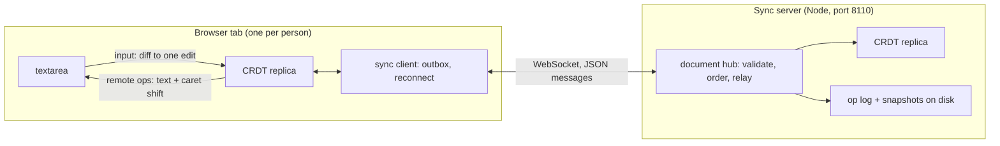

# Coedit

A real-time collaborative plain-text editor built on a hand-written sequence CRDT (RGA, the Replicated Growable
Array), in TypeScript: the CRDT, a WebSocket sync server (Node, `ws`) and a React client (Vite), as npm workspaces.

Several people edit one document at once, each in their own tab; edits merge without a central authority because
every replica applies the same commuting operations. Built to be explained end to end: one ordering rule with a short
proof, a strict wire format, and a test harness that is itself tested.

**Status: day 1 of 5.** Done: the design for all five days (DESIGN.md), the workspaces and CI, the wire format with a
strict decoder, the network simulator for convergence tests and its self-test, and the client's mapping from
textarea input to edits. Next: the CRDT itself (day 2), then sync and presence (day 3), persistence and tombstone
collection (day 4), release (day 5).

## Architecture



The server orders operations into a numbered log and relays each to every client, the sender included (the echo is
the acknowledgement). It applies every operation to its own replica first, so it refuses what would split replicas
apart. Built so far: the wire format, the edit mapping, the server's health endpoint; the rest is specified in
DESIGN.md.

## Layout

| Path                            | What                                                                      |
| ------------------------------- | ------------------------------------------------------------------------- |
| `DESIGN.md`                     | the specification: RGA and why it converges, wire format, sync protocol   |
| `packages/crdt/src/json.ts`     | a strict JSON reader (duplicate keys, lone surrogates, rounding: refused) |
| `packages/crdt/src/protocol.ts` | operations and protocol messages; strict decoder, canonical encoder       |
| `packages/crdt/test/harness/`   | the network simulator and the toy CRDTs that test it                      |
| `packages/crdt/scripts/`        | `harness-stats` (what schedules exercise) and `bench-codec`               |
| `packages/server/src/`          | the server: `/healthz` so far; `main.ts` is the command line              |
| `packages/client/src/edit.ts`   | textarea before/after + caret to one edit, in code points                 |
| `packages/client/src/App.tsx`   | the editor shell (local only until day 3)                                 |

## How to run

Node 22.18 or later: the TypeScript runs on Node's own type stripping, so nothing is compiled for the server, the
scripts or the tests (`tsc` only checks types).

```bash
npm ci
npm run check
```

`npm run check` runs the type checker, ESLint and Prettier, the tests (Node's built-in runner) and the client build;
CI runs the same steps on Node 22 and 24. The pieces:

```bash
npm start -w @coedit/server
```

```bash
npm run dev -w @coedit/client
```

The server listens on `127.0.0.1:8110` (`COEDIT_HOST`, `COEDIT_PORT`); `curl http://127.0.0.1:8110/healthz` gives
`{"status":"ok","protocol":1}`. The client is at `http://localhost:5173`; for now it edits a local document and shows
the edit each input became.

## Results (day 1)

Measured on an Apple M3 (macOS 26.6.2, Node 23.11.0, on AC). All inputs are synthetic.

- **The simulator catches each broken toy CRDT quickly**, and only with the freedom that exposes it
  (`npm run harness-stats -w @coedit/crdt -- 2000 200`; schedules until fast-check's first failure, over 200 seeds,
  every seed caught). "Before" is the first generator (edits one of three equally likely steps, fast-check's default
  array size), measured with the same script by restoring it from a copy; "now" is `38d06c8` onward:

  | Broken toy                        | Exposed by       | Median before | Median now | p95 now | Max now (before) |
  | --------------------------------- | ---------------- | ------------: | ---------: | ------: | ---------------: |
  | edits by index                    | concurrent edits |             3 |          1 |       5 |           8 (23) |
  | not idempotent                    | redelivery       |             6 |          3 |      11 |          23 (38) |
  | not idempotent                    | echo to sender   |             1 |          1 |       3 |            4 (6) |
  | drops a delete that arrives early | reordering       |            13 |          3 |      12 |          17 (96) |

  What a default schedule contains (2,000 samples), before and now: 1.3 and 4.9 edits, of which 0.4 and 3.4 are
  concurrent with an earlier edit; 25.6% and 68.2% of schedules have a concurrent edit; 0.2 and 1.3 redeliveries.

- **The strict decoder's cost** (`npm run bench-codec -w @coedit/crdt`, at `5c6354f`; median of 9 rounds of at least
  50 ms each, after warm-up):

  | Message                                    |     Bytes | `JSON.parse` | Strict reader | Full decode |   Encode |
  | ------------------------------------------ | --------: | -----------: | ------------: | ----------: | -------: |
  | one keystroke                              |       169 |      0.58 µs |       1.20 µs |     1.74 µs |  0.61 µs |
  | a paste: 100 inserts of 10,000 code points | 1,128,950 |       766 µs |      2,228 µs |    4,740 µs | 3,892 µs |
  | a delete of 1,000 spans                    |    62,890 |        96 µs |        406 µs |      556 µs |   177 µs |

  Before the profile-driven change in `5c6354f` the paste took 6,613 µs to decode and 5,231 µs to encode: a third of
  the time was the reader's character loop and a quarter was counting code points twice per insert.

- **Tests**: 69 in 18 suites, 0.64 s for the whole suite (`npm test`); 24 of them run fast-check properties.

## Tests

- `packages/crdt/test/json.test.ts`: the reader against `JSON.parse` (random values at any indentation; 20,000 random
  texts over JSON's alphabet, both surrogate halves included), every refusal, long strings either side of the scan
  window, a million-deep nesting attempt.
- `packages/crdt/test/protocol.test.ts`: round trips for every message kind with counters near both ends of the range;
  key order and whitespace not mattering; 5,000 randomly edited texts each refused or round-tripping; each refusal with
  its exact path; the encoder refusing NaN, -0, lone surrogates and extra keys.
- `packages/crdt/test/harness.test.ts`: the simulator's self-test in both directions (above), shrinking, replay.
- `packages/client/test/edit.test.ts`: any caret gives a correct edit; minimal without a caret; a random edit with the
  browser's caret comes back exactly; UTF-16/code-point conversion at every boundary.
- `packages/server/test/server.test.ts`: health, HEAD, 405, 404, default bind address, a taken port, close with a
  kept-alive connection, port parsing.

## Design decisions

The full reasoning is in DESIGN.md ("Decisions"). In short: a CRDT rather than OT (no central transform); RGA for its
one rule and short proof; code points as elements; any delivery order, with pending operations instead of causal
delivery; a strict reader because `JSON.parse` lets two replicas read one message differently; the server's echo as
the acknowledgement; Node's type stripping and test runner rather than a build step (and Vitest 5 and ESLint 10 don't
support this machine's Node 23).

## Limitations (day 1)

- The CRDT, sync, presence and persistence don't exist yet; the client edits locally.
- The server has no authentication: it binds 127.0.0.1 and will trust that clients are who they say.
- CI hasn't run yet: the GitHub repository couldn't be created this session (see the log).
- Measurements are from one laptop; the decode numbers are single-threaded microbenchmarks on synthetic messages.

## License

MIT
