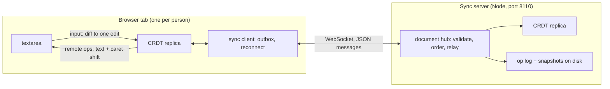

# Coedit

A real-time collaborative plain-text editor built on a hand-written sequence CRDT (RGA, the Replicated Growable
Array), in TypeScript: the CRDT, a WebSocket sync server (Node, `ws`) and a React client (Vite), as npm workspaces.

Several people edit one document at once, each in their own tab; edits merge without a central authority because
every replica applies the same commuting operations. Built to be explained end to end: one ordering rule with a short
proof, a strict wire format, and a test harness that is itself tested.

**Status: day 3 of 5.** Done: the design for all five days (DESIGN.md), the workspaces and CI, the wire format with a
strict decoder, the network simulator for convergence tests and its self-test, the client's mapping from textarea
input to edits (day 1); the CRDT itself: RGA with Lamport ids, runs placed by the skip rule, tombstones, operations in
any order, conflicts refused, positions as ids for presence, all property-tested for convergence (day 2); and sync:
the WebSocket server with one hub per document (a numbered log, the echo as acknowledgement, refusing what it can't
place or what would use up the clocks), the sync client (an outbox, catch-up then resend on reconnect, backoff), the
React editor patching remote changes into the textarea with the caret kept in place, remote cursors, offline editing,
and convergence tested end to end on the real server (day 3). Next: persistence and tombstone collection, Playwright
with two browsers (day 4), release (day 5).

## Architecture



The server orders operations into a numbered log and relays each to every client, the sender included (the echo is
the acknowledgement). It applies every operation to its own replica first, so it refuses what would split replicas
apart, and it accepts only operations whose dependencies it has placed, so its log is in causal order. Built so far:
everything but the op log and snapshots on disk (day 4); until then a server restart loses its documents, and
clients that held them stop with `ahead-of-server` rather than guess.

## Layout

| Path                              | What                                                                      |
| --------------------------------- | ------------------------------------------------------------------------- |
| `DESIGN.md`                       | the specification: RGA and why it converges, wire format, sync protocol   |
| `packages/crdt/src/rga.ts`        | the CRDT: insert, delete, waiting operations, conflicts, presence         |
| `packages/crdt/src/ids.ts`        | the id order (counter, then replica by code unit) and a map keyed by ids  |
| `packages/crdt/src/json.ts`       | a strict JSON reader (duplicate keys, lone surrogates, rounding: refused) |
| `packages/crdt/src/protocol.ts`   | operations and protocol messages; strict decoder, canonical encoder       |
| `packages/crdt/test/harness/`     | the network simulator, the toy CRDTs that test it, the RGA as a subject   |
| `test/`                           | repo-wide checks: the docs against the code, the workspace exports        |
| `packages/crdt/scripts/`          | `harness-stats`, `bench-codec`, `deep-convergence`, `worst-delete`        |
| `packages/server/src/hub.ts`      | one document: the server's replica, the numbered log, members, presence   |
| `packages/server/src/server.ts`   | HTTP (`/healthz`) and the `/sync` WebSocket: sessions, origins, heartbeat |
| `packages/server/src/main.ts`     | the command line (`COEDIT_HOST`, `COEDIT_PORT`, `COEDIT_ORIGINS`)         |
| `packages/client/src/sync.ts`     | the sync client: replica, outbox, echo matching, reconnect, presence      |
| `packages/client/src/edit.ts`     | textarea before/after + caret to one edit, in code points                 |
| `packages/client/src/textarea.ts` | remote changes applied to the textarea's text and selection               |
| `packages/client/src/App.tsx`     | the editor: textarea, remote cursors, status, offline switch              |
| `packages/client/scripts/`        | `sync-latency`: edit to acknowledgement and to other clients, loopback    |

## How to run

Node 22.18 or later: the TypeScript runs on Node's own type stripping, so nothing is compiled for the server, the
scripts or the tests (`tsc` only checks types).

```bash
npm ci
npm run check
```

`npm run check` runs the type checker, ESLint and Prettier, the tests (Node's built-in runner) and the client build;
CI runs the same steps on Node 22 and 24. The pieces:

```bash
npm start -w @coedit/server
```

```bash
npm run dev -w @coedit/client
```

The server listens on `127.0.0.1:8110` (`COEDIT_HOST`, `COEDIT_PORT`); `curl http://127.0.0.1:8110/healthz` gives
`{"status":"ok","protocol":1}`. Pages may connect from the client's dev server only; `COEDIT_ORIGINS` (origins
separated by commas) sets which. The client is at `http://localhost:5173`: open `http://localhost:5173/?doc=demo` in
two tabs (or two browsers) and type in both. The dev server passes `/sync` on to the sync server
(`COEDIT_SYNC_TARGET`, default `ws://127.0.0.1:8110`). "Go offline" closes the connection: edits made meanwhile wait
in the outbox and merge when it's pressed again. Each tab is a new replica, so a reload starts from the server's log
(edits not yet acknowledged are lost with the tab).

## Results (day 3)

Measured on the Apple M3 (macOS 26.6.2, Node 23.11.0), **on battery** (46% at the start of the session, 26% by
22:44), no sleep in `pmset -g log` during the session and none during each latency run (the script checks). All
inputs are synthetic; everything runs over loopback.

- **Edit to acknowledgement and to the other clients** (`npm run sync-latency -w @coedit/client`): a writer types one
  character every 5 ms at the end of the text, 2,000 edits of which the first 200 are a warm-up, paced by the clock;
  the server is its own process; the writer and the readers share one process. Nearest-rank percentiles, in
  milliseconds. The first three rows at `4214531` with the first review agent running tests alongside; the last two at
  `3a56512` with nothing of mine running (VLC was using about a fifth of a core); they agree:

  | Readers | Run              | ack p50 | ack p99 | ack max | remote p50 | remote p95 | remote p99 | remote max |
  | ------: | ---------------- | ------: | ------: | ------: | ---------: | ---------: | ---------: | ---------: |
  |       3 | 1 (review on)    |    0.56 |    1.94 |    5.19 |       0.77 |       1.57 |       2.48 |       6.02 |
  |       3 | 2 (review on)    |    0.55 |    2.19 |   13.32 |       0.75 |       1.44 |       2.71 |      13.59 |
  |      10 | 1 (review on)    |    0.54 |    1.86 |    4.58 |       1.00 |       2.05 |       3.26 |       8.22 |
  |       3 | 3 (nothing else) |    0.57 |    1.90 |   36.68 |       0.78 |       1.53 |       2.43 |      36.88 |
  |      10 | 2 (nothing else) |    0.54 |    2.10 |    5.39 |       1.02 |       2.13 |       3.26 |       6.02 |

  "remote" counts each reader's copy (5,400 and 18,000 samples). A round trip through the server costs about half a
  millisecond here; network latency would dominate any real deployment.

- **Convergence end to end** (`packages/client/test/sync-convergence.test.ts`, 100 generated schedules on the real
  server, about 4 s): five runs made 1,012 to 1,134 edits and 153 to 179 dropped connections each, plus offline
  spells; every schedule ended with every client's replica state equal to the server's. The test fails below 700
  edits or 100 drops.
- **Checking the largest delete** (`Rga.ready`, run by run): 1,000 lookups for 1,000 spans of 10,000 ids over one
  run, counted in `rga-ready.test.ts`; an id-by-id version took about 110 ms for the same delete.
- **One message of overlapping deletes** (the review's case, `review-d3-overlap-dos.test.ts`): before the fix it kept
  the event loop busy 5.3 to 5.5 s in the review's runs and 12.9 s in mine on battery; now its first delete is
  refused at once.
- **A long catch-up** (`review-d3-catchup-drop.test.ts`): a fresh client joining a document whose log is about 32
  MiB (801 entries), with the slow-reader limit at 256 KiB, now receives all of it (the test, which builds the log
  first, takes about 3 s); before the fix it received nothing and was dropped on every attempt.
- **Tests**: 252 at the start of the day (`c60a050`), 382 at `3a56512` (`npm test`); CI green on Node 22 and 24.

## Results (day 2)

Measured on the same Apple M3 (macOS 26.6.2, Node 23.11.0, on AC, no sleep in `pmset -g log`). All inputs are
synthetic.

- **Convergence at depth**: every convergence case passes at 20,000 schedules, by
  `npm run deep-convergence -w @coedit/crdt` at `a2ea2e7` (16:00 to 16:02, nothing else of mine running; macOS's
  `mediaanalysisd` was using a core). Its counts are fast-check's own. An earlier run of the same cases at `7b2e0d3`,
  by a one-off script with a review agent running alongside, gave the same within 0.3 s a case.

  | Case                                      | Seconds |
  | ----------------------------------------- | ------: |
  | 2 to 5 replicas, every freedom on         |     7.4 |
  | long schedules (80 steps), up to 6        |    49.0 |
  | causal delivery, no duplicates            |     8.3 |
  | clocks near 2^31                          |     6.6 |
  | clocks near 2^53 - 1 - 10,000             |     6.6 |
  | clocks far apart (0 to 2^53 - 1 - 10,000) |     9.9 |
  | all six                                   |    87.8 |

- **What the schedules exercise** (the coverage test in `packages/crdt/test/rga-convergence.test.ts`, 300 schedules,
  seed 1): an operation waited for a dependency in 61% of schedules (183), one delivery returned several changes
  (released waiting operations, or a scattered delete) in 51% (153), and 54% of deliveries (4,316 of 7,958) changed
  nothing (duplicates, echoes, waits). The test fails below about three quarters of each.
- **Every mechanism is load-bearing**: each one-line mutant of `rga.ts` and `ids.ts` run today (the skip rule removed
  or reversed, ties not broken by replica, `localeCompare` for the id order, the cascade of waiting runs dropped,
  either pre-delete path, the clocks' updates, the change index shift, the four conditions of the duplicate check,
  the splits and the clock's limit off by one, the presence methods counting tombstones) fails at least one test,
  most of them 3 to 7. Two guards failed none and were found to be unobservable (see the WALKTHROUGH); one was
  removed.
- **The worst delete** (`npm run worst-delete -w @coedit/crdt` at `617d125`): the wire format's largest, 10 million
  absent ids in a 48,936-byte message, is refused for the capacity in 69 ms, nothing changed. With `-- 800 twice`: 8
  million ids deleted ahead from a 39,136-byte message, 2.4 s and +651 MiB of heap, and a second such delete refused
  in 1.1 s (the count of its ids); review 4's runs of the same gave 2.2 s and 1.0 s. See "Limitations (day 2)".

## Results (day 1)

Measured on an Apple M3 (macOS 26.6.2, Node 23.11.0, on AC, awake throughout). All inputs are synthetic.

- **The simulator catches each broken toy CRDT within a few schedules**, and only with the freedom (or check) that
  exposes it (`npm run harness-stats -w @coedit/crdt -- 2000 200` at `102e41a`, and the same at `7ae190c`; schedules fast-check ran up to and
  including the first failure, over 200 seeds; every seed caught every toy):

  | Broken toy                           | Exposed by       | Median | p95 | Max |
  | ------------------------------------ | ---------------- | -----: | --: | --: |
  | edits by index                       | concurrent edits |      1 |   5 |   8 |
  | not idempotent                       | redelivery       |      2 |   4 |   8 |
  | not idempotent                       | echo to sender   |      1 |   2 |   5 |
  | drops a delete that arrives early    | reordering       |      2 |   6 |  11 |
  | removes a deleted character outright | the state check  |      1 |   3 |   8 |

- **What a default schedule contains** (same command, 2,000 samples), against the first generator, in which an edit
  was one of three equally likely steps at fast-check's default array size (measured by restoring it from a copy):

  |                                          |   First generator |  Now (`e96122f`) |
  | ---------------------------------------- | ----------------: | ---------------: |
  | edits per schedule                       |               1.3 |              5.3 |
  | of them concurrent with an earlier edit  |               0.4 |              3.8 |
  | schedules with a concurrent edit         |             25.6% |            71.3% |
  | redeliveries per schedule                |               0.3 |              2.0 |
  | early-delete toy: schedules until caught | median 13, max 96 | median 2, max 11 |

- **The strict decoder's cost** (`npm run bench-codec -w @coedit/crdt` at `e96122f`; median of 9 rounds of at least
  50 ms each, after warm-up):

  | Message                                    |     Bytes | `JSON.parse` | Strict reader | Full decode |   Encode |
  | ------------------------------------------ | --------: | -----------: | ------------: | ----------: | -------: |
  | one keystroke                              |       169 |      0.58 µs |       1.20 µs |     1.78 µs |  0.63 µs |
  | a paste: 100 inserts of 10,000 code points | 1,128,950 |       772 µs |      2,252 µs |    4,799 µs | 3,883 µs |
  | a delete of 1,000 spans                    |    62,890 |        95 µs |        414 µs |      566 µs |   174 µs |

  Before the profile-driven change in `5c6354f` the paste took 6,613 µs to decode and 5,231 µs to encode: a third of
  the time was the reader's character loop and a quarter was counting code points twice per insert.

- **Tests**: 138 in 31 suites, 3.9 s for the whole suite (`npm test`, at `d7eb9bb`); 2.6 s of it is the simulator's
  self-test, whose check that each step changed only its own replica snapshots every replica once a step (without
  snapshots it takes 0.4 s). The must-pass simulator properties also passed at 20,000 schedules each (a one-off run
  at `c1d40d0`, 0.3 to 2.4 s per case).

## Tests

- `packages/crdt/test/rga-convergence.test.ts`: RGA through the simulator with every freedom on, the real codec as
  the transport, the state check compulsory, the local model on, and every delivery's changes replayed; 2 to 5
  replicas, long schedules with up to 6, causal delivery, clocks near 2^31, near 2^53 and far apart; a coverage test
  pinning what the schedules exercise.
- `packages/crdt/test/rga-order.test.ts`: the sequence against an independent implementation of the spec (the origin
  tree, children largest first, in preorder) over 1,000 editing sessions in generated orders.
- `packages/crdt/test/rga.test.ts`: one behaviour at a time: local edits and their operations, remote operations and
  their visible changes, concurrent inserts at one spot, a larger insert's subtree skipped, inserts after tombstones,
  scattered deletes, duplicates and echoes, waiting chains, deletes ahead, refusals that change nothing, `state()`.
- `packages/crdt/test/rga-pending.test.ts`: over editing sessions with operations withheld, state and `pending` depend
  only on which operations arrived; `pending` matches a model; the rest delivered later converges.
- `packages/crdt/test/rga-conflicts.test.ts`: every way to reuse a known id is refused atomically, waiting runs
  included, and whether two inserts conflict doesn't depend on their order.
- `packages/crdt/test/rga-intention.test.ts`: concurrent typists at one spot keep their runs whole; backward typing's
  interleave pinned. `rga-presence.test.ts`: ids for cursors, round trips, a cursor following its text.
  `rga-limits.test.ts`: splitting long pastes and large deletes, the clock's end. `ids.test.ts`: the id order.
- `packages/crdt/test/json.test.ts`: the reader against `JSON.parse` (random values at any indentation; 20,000 random
  texts over JSON's alphabet, both surrogate halves included), every refusal, long strings either side of the scan
  window, a million-deep nesting attempt.
- `packages/crdt/test/protocol.test.ts`: round trips for every message kind with counters near both ends of the range;
  key order and whitespace not mattering; 5,000 randomly edited texts each refused or round-tripping; each refusal with
  its exact path; the encoder refusing NaN, -0, lone surrogates and extra keys.
- `packages/crdt/test/harness.test.ts`: the simulator's self-test in both directions (a correct toy passes; four broken
  ones fail only with the freedom that exposes them), shrinking on fixed seeds, replay.
- `packages/crdt/test/harness-mechanics.test.ts`: each delivery mechanism on hand-written schedules (picks, flush
  order, redelivery, echo, every replica compared, a sender's later changes not reaching the network, a step that
  changes a bystander, the `state()` opt-in, the transport).
- `packages/crdt/test/harness-coverage.test.ts`: what 2,000 default schedules contain (replica counts, lengths, every
  alphabet unit and edit size, positions at the start, middle and end of real text).
- `packages/client/test/edit.test.ts`: any caret gives a correct edit; minimal without a caret; a random edit with the
  browser's caret comes back exactly; UTF-16/code-point conversion at every boundary.
- `packages/server/test/`: health, HEAD, 405, 404, the default bind address, a taken port, close mid-request, port
  parsing; `main.test.ts` runs the command line as a child process (signals, exit codes, IPv6, `COEDIT_ORIGINS`);
  `signal-order.test.ts` checks, from inside the child, that the signal handlers exist when "listening" is printed.
- `packages/server/test/hub.test.ts` (day 3): the document hub without sockets: numbering and relay, catch-up from any
  `have` in batches, `ahead-of-server`, replacement, a resent insert not logged and a resent delete logged, each
  refusal (origin missing, delete naming a missing id, a reused id, counters past the clock, a full document) leaving
  the server's state byte for byte as it was, the clock argument run to the end with a capacity of 1,000, presence.
- `packages/server/test/sync.test.ts` (day 3): the endpoint over real sockets: relay, catch-up, presence and the null
  on leaving, each protocol error's code and close, the hello timeout, 1 MiB read and one byte more closed with 1009,
  replacement (4001), 404, 403 by origin, a stalled reader dropped while the writer carries on, the heartbeat
  dropping a client that doesn't answer pings.
- `packages/client/test/sync-unit.test.ts` (day 3): the sync client against a scripted socket: the joining sequence,
  the outbox held, echoed, resent from the right place and batched, an identical delete as the echo, presence order on
  reconnect, hold and release, each fatal code against `server-error`, the backoff's delays exactly, an error with no
  close (Node's WebSocket after a refused connection).
- `packages/client/test/sync.test.ts` and `sync-convergence.test.ts` (day 3): sync clients on the real server over
  Node's own WebSocket: converging, offline edits, a late joiner on a 2,500-entry log, cursors, a client started before
  the server, a server that lost its log, a full document; and 100 generated schedules of edits, dropped connections,
  offline spells and pauses across 2 to 4 clients, after each of which every client's replica state is the server's
  and the text it patched from the reported changes is the server's text.
- `packages/client/test/textarea.test.ts` (day 3): remote changes on the textarea's text and selection, each rule,
  surrogate pairs, and a property over a real replica: the patched text is the replica's and the caret stays next to
  the element it was after.
- `packages/crdt/test/rga-ready.test.ts`, `batch.test.ts` (day 3): `Rga.ready` against an id-by-id check and with its
  lookups counted; the pre-encoded messages against the encoders, batches within 1,000 operations and 1 MiB.
- `test/docs.test.ts` (parsing in `test/docs.ts`): every npm script, workspace, repo path and `:line` the docs name
  exists, and the ports and response they quote are the code's; the parser is also tested on twelve bad fragments.
  `test/exports.test.ts`: every workspace export imports.
- `review1-*.test.ts`, `review2-*.test.ts`: the reviews' findings, each of which failed before its fix.

## Review of day 3

One review agent at a time, in its own worktree, with a correctness brief listing the day's claims, writing each
finding as a failing test (the `review-d3-` files in `packages/server/test/` hold them).

**Round 1** (at `f76b10f`, everything built today; about 18 minutes) reproduced 3 defects, all in the server:

1. **A long document couldn't be opened.** `join` wrote the whole catch-up at once and the slow-reader rule counted it,
   so a client reading as fast as it could was dropped part way through once the log after its `have` passed the limit
   plus what the kernel absorbs, then dropped again on every reconnect: with the default 16 MiB, about 150,000
   one-character inserts. The catch-up now goes one batch at a time, each once the one before is written out, and only
   live sends count (`ca5cdae`).
2. **One message under 1 MiB blocked the server for about 5 s**: a delete may name the same 10,000 ids in each of its
   1,000 spans, and applying walks every id named. No replica writes overlapping spans, so the server refuses them;
   then a delete's cost is bounded by the document's size (`f0e4ef8`).
3. **A refused handshake, reset at once, crashed the server**: Node removes its own socket error listener before
   `'upgrade'`, and the 404/403 answer was written without one, so a reset (EPIPE) was thrown (`d9429a4`).

It also noted that the server didn't check an insert was under the sender's own replica id (a client could take
another's next ids and get it stopped; refused since `060b0af`), that a refused hello created a document, and that
`COEDIT_ORIGINS` accepted port 99999 and upper-case hosts (`692bb29`). Of its 44 mutants, the 10 it listed as
surviving were: two of the batch size arithmetic, the hello timer's clear, the session's readyState guard, the client
ignoring its own cursor, the welcome-behind check (all pinned in `a41bb33`), the origin port (pinned in `692bb29`),
and three equivalent: two of the sync client's `#sent` counter, which was always 0 when read (removed, `0c487d3`), and
one covered by `leave` being idempotent. Its docs list (a resent delete is logged again; ws closes 1009 and 1007
without an error message; stale comments) is fixed in the code and DESIGN.md.

**Round 2** (at `692bb29`, round 1's fixes only, "what did each fix break or miss?"; about 22 minutes) reproduced 5
more, each now a test in `packages/server/test/` (the `review-d3r2-` files):

1. **The overlap rule bounded one delete, not one message**: 1,000 disjoint deletes each naming a whole
   200,000-character document, in one 0.9 MiB message, took 3.9 s. A message's deletes may now name at most as many
   ids as the document holds, which no honest client passes, since it deletes each element once (`578c354`).
2. **Presence relays during a catch-up counted the batch in flight** against the slow-reader limit, so with a limit
   under 1 MiB one presence message dropped a client reading its catch-up. A member catching up now gets nothing but
   its catch-up, then the cursors shown (`5b9bdc5`).
3. **Each catch-up batch measured the next 1,000 entries** to keep the few that fit: a 117 MiB catch-up took 5.5 s
   against 0.18 s for batching the log once. `batchEnd` measures only what the batch holds (`5b9bdc5`).
4. **A refused handshake's socket was never destroyed**, so a client keeping its end open held `close()`, and a
   SIGTERM, waiting for good. It's destroyed once the answer is written (`41b5103`).
5. **`COEDIT_ORIGINS` still took spellings no browser sends** (`http://localhost:80`, `127.1`, long IPv6). An origin
   must now be what `new URL(origin).origin` gives back (`3a56512`).

Four of its mutants survived: the overlap comparator ignoring the replica, a catch-up batch with no byte limit, a
member sent its own cursor (all three pinned, `578c354`, `5b9bdc5`), and `sent()` called on a write error (nearly
equivalent: the connection is closing then). A randomized hub simulation it ran (150 seeds of 60 steps: joins,
replacements, leaves, presence, multi-batch logs, synchronous and asynchronous writes) found no entry skipped,
repeated or out of order. It also notes that the replica-id check can be got round by saying `hello` with a victim's
id, which presence reveals: nothing is authenticated (see "Limitations (day 3)"). No third round: the session's power
ran low (17% at 23:13).

## Review of day 2

One review agent at a time, each in its own worktree with a correctness brief, writing each finding as a failing test
(`packages/crdt/test/review1-rga.test.ts` holds them).

**Round 1** (at `0cbad60`, the core with its tests; 14 minutes) reproduced 3 defects and one rule that was too broad:

1. **`pending` depended on arrival order**: only the first delete naming a missing id waited for it, so two deletes
   naming the same missing id counted as one or two. I had found and fixed it meanwhile (`63e271a`, with
   `rga-pending.test.ts`); the review's honest-replica case is kept as a test.
2. **Releasing about 110,000 runs waiting on one element overflowed the stack** (`queue.push(...waiting)`) after the
   releasing insert was placed and the runs taken out of the waiting map: they were lost for good (known, so a resend
   was a duplicate; never placed; not pending). `state()` spread the same list. Both push one at a time; an ESLint
   rule (broadened in rounds 2 to 4 to every spread into a call and every visible use of `apply` or `Reflect`; it
   can't see a key held in a variable, and `test/lint-rule.test.ts` pins both) keeps it out of the CRDT;
   the test runs the fan-out in a child process with a 100 KB stack,
   where the old code overflowed at 20,000 runs (`584a0fd`).
3. **`edit()` returned the origin element's own id object** as the insert's origin, so changing the returned operation
   renamed an element inside the replica. Fixed with a copy, and a property that changes every field of every
   returned operation (`d2eaeab`).
4. **The clock moved for every span of every delete**, so one delete naming 2^53 - 1 of any replica stopped this
   replica's inserts for good. Only spans under the replica's own id need to (`410c093`).

Of its mutants, 4 survived the tests at `0cbad60`: `length` counting elements deleted ahead and `state()` listing
waiting runs in arrival order (both caught by `rga-pending.test.ts` by then, and pinned directly in `55dec77`), the
delete's clock update applied to the first span only (pinned in `410c093`), and releasing waiting runs in reverse
order, which is harmless (the changes are still a valid sequence). Five more were equivalent. Its census of 3,000
schedules (seed 7) showed what the convergence generator reaches: an insert waiting for its origin in 52.1% of
schedules, a chain of two or more waiting runs in 9.7%, a delete naming an id another delete already waits for in
17.7%, a delete of an element in a waiting run in 14.6%, a duplicate of a waiting run in 7.4%; and what it never
makes: conflicts, forged ids, a fan-out large enough for finding 2, or dependencies that never arrive (which
`rga-pending.test.ts` covers by withholding operations).

**Round 2** (on `0cbad60..55dec77`, round 1's fixes and everything else since; 14 minutes) found the fixes themselves
sound and reproduced one older defect that contradicted a promise DESIGN.md had just made:

1. **A V8 Map holds at most 2^24 entries**, and two valid deletes of 10 million absent ids each overflowed the
   deleted-ahead map partway through the second, leaving it half applied and uncounted. A replica now has a capacity
   (of elements, ids deleted ahead and waiting deletes, each) and refuses an operation past it before changing
   anything (`80b615f`; 2^24 - 1 then, 2^23 - 1 after round 3); the review's own case at full size passes.

The rest was about measuring and testing: both scripts passed their smoke tests with six one-line mutants (a deep run
of 1 schedule still printed "20,000 pass"; worst-delete computed its id count from its arguments), so they now print
fast-check's count and the replica's own (`Rga.sizes()`), and five of the six fail (`4ec96f2`); the lint rule missed
eight ways to pass a list as arguments, all flagged now (`19fd1f7`); a key of a waiting delete by its ids rather than
its spans survived (pinned, `a2ea2e7`); and five docs claims were wrong (a 60 KB message that is 49 KB, the clock
"largest counter seen", and others; `c7c6237`). Its census of 4,000 editing sessions: a delete waits in 52.5%, a
waiting delete is resent in 33.0%, concurrent identical deletes in 13.3%, a delete naming an id twice in none.

**Round 3** (on round 2's fixes only, `55dec77..c7c6237`; 11 minutes) found round 2's capacity too high: a Map's table
holds 2^24 entries **deleted ones included**, and a full table only compacts when half of it is deleted entries, so a
map that loses entries (deleted-ahead ids do, whenever their insert arrives) could still throw halfway with about 2^23
live ones; and IdMap counted an entry before its `set` succeeded. Measured with a plain Map holding N entries while
deleting one and adding one, 20 million times: N = 2^23 - 1 and 2^23 hold, 2^23 + 2 throws. The capacity is now
2^23 - 1, IdMap counts after the set (`617d125`); a one-off run churning 8.38 million ids through a full deleted-ahead
map raised nothing. It also found four checks' boundaries and `sizes()` unpinned (pinned), four ways round the lint
rule plus a false positive (fixed, `f8b2a40`), a heap figure printed in the wrong unit passing the smoke test, and
stale wording about the lint rule and the capacity.

**Round 4** (on round 3's fixes only, `c7c6237..ee04965`; 8 minutes) confirmed the capacity's reasoning on this
Node (a full table takes a set only while at most 2^23 entries are live) and found: nine more ways round the lint rule,
and that no test linted anything (the rule now also refuses built-up and destructured keys, `globalThis` and property
descriptors, says it can't see a key held in a variable, and `test/lint-rule.test.ts` runs it on 21 refused forms,
the allowed ones and the two it can't see; `09891e7`); and three of round 3's changes untested (IdMap's count after its
set, the capacity getter, the script's refused first delete; `bd3f616`). No defect in the CRDT itself.

## Review of day 1

Two review agents, one after the other, each in its own worktree with a correctness brief, writing each finding as a
failing test.

**Round 1** (at `e688359`, 12 minutes) found 8 defects:

1. **The simulator handed every replica the same operation object.** A toy that never applies a remote delete, and
   instead flags the element object it keeps (the received operation itself), passed 2,000 schedules: the flag
   travelled through the shared object. Fixed with a copy at send and at each delivery (`0023578`); a test for each.
2. The final flush was a random order only for its first 10 or so deliveries (fast-check's default size), oldest-first
   after that (`36dd34e`).
3. The index toy could diverge with no concurrency (an edit's delete and insert arrived reordered), contradicting its
   own comment; one operation per edit now (`0023578`).
4. The shrink-length test ran unseeded and failed on about 1.5% of seeds (`36dd34e`).
5. `diffText`'s comment and DESIGN were wrong: the caret can make the edit bigger than the smallest (it is then the
   edit that was typed). Docs fixed, behaviour pinned (`14efa2e`).
6. A NaN or fractional caret threw (`14efa2e`).
7. The encoder could be made to write what the decoder refuses, through an Array subclass with `toJSON` or an array
   with its own `map` (`02940be`).
8. `startServer({ host: '' })` listened on every interface (`43926d7`; `main.ts` already refused it since `119233c`).

It also listed about 15 mutations no test caught. Most weakened the schedule generator (2 replicas, edits only at
position 0, one-letter inserts...), which the self-test can't see because weak schedules still catch the broken toys;
`harness-coverage.test.ts` and `harness-mechanics.test.ts` pin them now. Every listed survivor was re-run here as a
mutant afterwards and fails a test.

**Round 2** (on everything since `e688359`, round 1's fixes included; 11 minutes) found 4 more, two of them in round
1's fixes:

1. **The array copy of `02940be` read the length live**, so an array whose index getter appends to it grew past the
   1,000-item limit while being copied (`f364ec0`).
2. **Replicas could still share state another way**: a toy keeping elements in a cache common to all replicas (a
   static Map of nodes) passed 2,000 schedules. The simulator now checks that a local edit changes only its own
   replica and a delivery only its target (`de9e787`; halved in cost in `d7eb9bb`). Also from it: `state()` all or
   none, a `requireState` option, a pluggable transport.
3. The docs test missed seven forms of command and path, each now tested (`d12991c`).
4. A failing server test hung the suite and left `main.ts` listening; children are now killed in cleanup and `npm
test` has a per-test timeout (`c646344`).

Its eleven surviving mutants (the control-character range edges, three of them; the skip-count bound; edits only by
replicas 0 and 1; the alphabet constant, two ways; redelivery of the last message; `state()` skipped when one replica
lacks it; a rounded caret; the IPv6 bind message) were each
re-run here after the new tests: all fail a test.

I found one more myself: the per-delivery copies broke `harness-stats`' counting, which recognised operations by
identity (0.0 redeliveries; echoes counted as receipts); fixed in `102e41a`, and every number above re-measured after
it.

## Design decisions

The full reasoning is in DESIGN.md ("Decisions"). In short: a CRDT rather than OT (no central transform); RGA for its
one rule and short proof; code points as elements; any delivery order, with pending operations instead of causal
delivery; a strict reader because `JSON.parse` lets two replicas read one message differently; the server's echo as
the acknowledgement; Node's type stripping and test runner rather than a build step (and Vitest 5 and ESLint 10 don't
support this machine's Node 23).

## Limitations (day 3)

- **No persistence yet** (day 4): a server restart loses every document. A client that held one stops with
  `ahead-of-server` and keeps its text on screen, but can't rejoin without a reload, which loses what it hadn't had
  acknowledged.
- **Nothing is authenticated.** The server binds 127.0.0.1, checks the page's origin, and trusts each client's
  replica id. A client that reuses another's id (none would by accident: they're 16 random bytes) can have its edits
  refused, and two connections with the same id replace each other. The server refuses inserts under another
  connection's id, but a client can say `hello` with any id (presence reveals the others').
- **A message's cost is bounded by the document's size, not by the message's**: a client may send deletes naming
  the whole document in every message, each logged, and nothing limits how often.
- **The server refuses rather than repairs**: an operation it refuses closes that client for good (the editor says so
  and keeps the text). Only a buggy or tampered client sends one, but a client that hits the document's capacity is
  stopped the same way.
- **The outbox lives in memory**: closing a tab loses edits the server hasn't acknowledged.
- **Every operation still scans one array**, O(n) in elements including tombstones, on the server too; nothing is
  collected yet (day 4 measures and collects). The editor redraws the cursor mirror from the whole text on every
  change.
- **Deletes are logged every time they arrive**, so a client can grow a document's log (held in memory) without
  bound by sending deletes of text already deleted, about 1 MiB a message; and every document name anyone says
  `hello` to stays in memory for the server's lifetime. Both wait for day 4's persistence and a retention rule.
- **The cursor mirror only approximates the textarea's layout** (same font, padding, wrapping and scrollbar gutter);
  a browser that wraps a textarea differently from a div would draw a remote caret off by a line.
- Day 2's limits that day 3 closes: clients now receive only what the server accepted, and the server refuses a
  delete naming ids it lacks (checking spans run by run), so the 10-million-id delete never reaches a client; the
  server keeps the first of two conflicting inserts and refuses the second; and it refuses counters more than its
  capacity past its clock, so no client can use up the clocks.

## Limitations (day 2)

- Sync, presence over the network and persistence don't exist yet; the client edits locally (day 3 and 4).
- Every operation scans one array: O(n) in the document's elements, tombstones included, and tombstones are never
  collected yet. Day 4 measures it and collects what it can prove unneeded.
- **One valid delete can name 10 million ids** (1,000 spans of 10,000), and a replica holding none of them records
  each as deleted ahead, up to its capacity of 2^23 - 1 (8,388,607): the full 10 million are refused, 8 million (800
  spans, a 39,136-byte message) take 2.4 s and +651 MiB of heap (0.16 s and +82 MiB for 100 spans, 4,836 bytes),
  measured with `npm run worst-delete -w @coedit/crdt` (add `-- 800` or `-- 100` for 800 or 100 spans). Before the
  capacity, the full delete took 3.6 s and +982 MiB. In
  Coedit's topology clients only receive what the server accepted, and the server (day 3) must refuse operations whose
  dependencies it lacks, checking spans against runs rather than id by id. Storing absent ids as spans would fix it in
  the CRDT itself. The capacity is also what keeps V8's Maps from refusing a `set` halfway: a Map's table holds 2^24
  entries, deleted ones included, so one that has lost entries can fail with about 2^23 live ones (reviews 2 and 3).
  It also caps a document at 8,388,607 elements, tombstones and waiting ones included.
- Which of two conflicting inserts a replica keeps depends on which arrived first; that the pair conflicts doesn't. The
  server settles it by refusing the second (day 3).
- A peer can exhaust a replica's clock with an insert at counter 2^53 - 1, or a delete naming this replica's own id
  at 2^53 - 1 (a delete naming another replica's ids no longer moves the clock, since review 1); edits that need ids
  are then refused. Only a buggy or tampered peer can, and the server will have to refuse such counters.
- Text typed backwards at one spot interleaves with concurrent text typed the same way (RGA's known weakness, pinned
  by a test); grapheme clusters can be split by concurrent edits (code points can't).

## Limitations (day 1)

- The CRDT, sync, presence and persistence don't exist yet; the client edits locally.
- The server has no authentication: it binds 127.0.0.1 and will trust that clients are who they say.
- CI hasn't run yet: the GitHub repository couldn't be created this session. The whole check passes in a clean clone
  with `npm ci` on Node 23; Node 22 and 24, which CI uses, are not installed here.
- The simulator's convergence check can't catch an id comparison that is wrong only across machines (such as
  `localeCompare`): within one process a comparator used consistently converges. Day 2 tests the id order directly.
- Its default transport (`structuredClone`) keeps Maps, BigInts and -0, which JSON on the wire wouldn't; day 2 should
  pass the real codec as the transport.
- Measurements are from one laptop; the decode numbers are single-threaded microbenchmarks on synthetic messages.

## License

MIT
