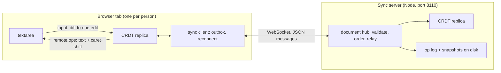

# Coedit

A real-time collaborative plain-text editor built on a hand-written sequence CRDT (RGA, the Replicated Growable
Array), in TypeScript: the CRDT, a WebSocket sync server (Node, `ws`) and a React client (Vite), as npm workspaces.

Several people edit one document at once, each in their own tab; edits merge without a central authority because
every replica applies the same commuting operations. Built to be explained end to end: one ordering rule with a short
proof, a strict wire format, and a test harness that is itself tested.

**Status: day 1 of 5.** Done: the design for all five days (DESIGN.md), the workspaces and CI, the wire format with a
strict decoder, the network simulator for convergence tests and its self-test, and the client's mapping from
textarea input to edits. Next: the CRDT itself (day 2), then sync and presence (day 3), persistence and tombstone
collection (day 4), release (day 5).

## Architecture



The server orders operations into a numbered log and relays each to every client, the sender included (the echo is
the acknowledgement). It applies every operation to its own replica first, so it refuses what would split replicas
apart. Built so far: the wire format, the edit mapping, the server's health endpoint; the rest is specified in
DESIGN.md.

## Layout

| Path                            | What                                                                      |
| ------------------------------- | ------------------------------------------------------------------------- |
| `DESIGN.md`                     | the specification: RGA and why it converges, wire format, sync protocol   |
| `packages/crdt/src/json.ts`     | a strict JSON reader (duplicate keys, lone surrogates, rounding: refused) |
| `packages/crdt/src/protocol.ts` | operations and protocol messages; strict decoder, canonical encoder       |
| `packages/crdt/test/harness/`   | the network simulator and the toy CRDTs that test it                      |
| `test/`                         | repo-wide checks: the docs against the code, the workspace exports        |
| `packages/crdt/scripts/`        | `harness-stats` (what schedules exercise) and `bench-codec`               |
| `packages/server/src/`          | the server: `/healthz` so far; `main.ts` is the command line              |
| `packages/client/src/edit.ts`   | textarea before/after + caret to one edit, in code points                 |
| `packages/client/src/App.tsx`   | the editor shell (local only until day 3)                                 |

## How to run

Node 22.18 or later: the TypeScript runs on Node's own type stripping, so nothing is compiled for the server, the
scripts or the tests (`tsc` only checks types).

```bash
npm ci
npm run check
```

`npm run check` runs the type checker, ESLint and Prettier, the tests (Node's built-in runner) and the client build;
CI runs the same steps on Node 22 and 24. The pieces:

```bash
npm start -w @coedit/server
```

```bash
npm run dev -w @coedit/client
```

The server listens on `127.0.0.1:8110` (`COEDIT_HOST`, `COEDIT_PORT`); `curl http://127.0.0.1:8110/healthz` gives
`{"status":"ok","protocol":1}`. The client is at `http://localhost:5173`; for now it edits a local document and shows
the edit each input became.

## Results (day 1)

Measured on an Apple M3 (macOS 26.6.2, Node 23.11.0, on AC, awake throughout). All inputs are synthetic.

- **The simulator catches each broken toy CRDT within a few schedules**, and only with the freedom (or check) that
  exposes it (`npm run harness-stats -w @coedit/crdt -- 2000 200` at `102e41a`; schedules fast-check ran up to and
  including the first failure, over 200 seeds; every seed caught every toy):

  | Broken toy                           | Exposed by       | Median | p95 | Max |
  | ------------------------------------ | ---------------- | -----: | --: | --: |
  | edits by index                       | concurrent edits |      1 |   5 |   8 |
  | not idempotent                       | redelivery       |      2 |   4 |   8 |
  | not idempotent                       | echo to sender   |      1 |   2 |   5 |
  | drops a delete that arrives early    | reordering       |      2 |   6 |  11 |
  | removes a deleted character outright | the state check  |      1 |   3 |   8 |

- **What a default schedule contains** (same command, 2,000 samples), against the first generator, in which an edit
  was one of three equally likely steps at fast-check's default array size (measured by restoring it from a copy):

  |                                          |   First generator |  Now (`e96122f`) |
  | ---------------------------------------- | ----------------: | ---------------: |
  | edits per schedule                       |               1.3 |              5.3 |
  | of them concurrent with an earlier edit  |               0.4 |              3.8 |
  | schedules with a concurrent edit         |             25.6% |            71.3% |
  | redeliveries per schedule                |               0.3 |              2.0 |
  | early-delete toy: schedules until caught | median 13, max 96 | median 2, max 11 |

- **The strict decoder's cost** (`npm run bench-codec -w @coedit/crdt` at `e96122f`; median of 9 rounds of at least
  50 ms each, after warm-up):

  | Message                                    |     Bytes | `JSON.parse` | Strict reader | Full decode |   Encode |
  | ------------------------------------------ | --------: | -----------: | ------------: | ----------: | -------: |
  | one keystroke                              |       169 |      0.58 µs |       1.20 µs |     1.78 µs |  0.63 µs |
  | a paste: 100 inserts of 10,000 code points | 1,128,950 |       772 µs |      2,252 µs |    4,799 µs | 3,883 µs |
  | a delete of 1,000 spans                    |    62,890 |        95 µs |        414 µs |      566 µs |   174 µs |

  Before the profile-driven change in `5c6354f` the paste took 6,613 µs to decode and 5,231 µs to encode: a third of
  the time was the reader's character loop and a quarter was counting code points twice per insert.

- **Tests**: 111 in 30 suites, 1.5 s for the whole suite (`npm test`). The must-pass simulator properties also passed
  at 20,000 schedules each (a one-off run, 0.3 to 2.4 s per case).

## Tests

- `packages/crdt/test/json.test.ts`: the reader against `JSON.parse` (random values at any indentation; 20,000 random
  texts over JSON's alphabet, both surrogate halves included), every refusal, long strings either side of the scan
  window, a million-deep nesting attempt.
- `packages/crdt/test/protocol.test.ts`: round trips for every message kind with counters near both ends of the range;
  key order and whitespace not mattering; 5,000 randomly edited texts each refused or round-tripping; each refusal with
  its exact path; the encoder refusing NaN, -0, lone surrogates and extra keys.
- `packages/crdt/test/harness.test.ts`: the simulator's self-test in both directions (a correct toy passes; four broken
  ones fail only with the freedom that exposes them), shrinking on fixed seeds, replay.
- `packages/crdt/test/harness-mechanics.test.ts`: each delivery mechanism on hand-written schedules (picks, flush
  order, redelivery, echo, every replica compared, a sender's later changes not reaching the network).
- `packages/crdt/test/harness-coverage.test.ts`: what 2,000 default schedules contain (replica counts, lengths, every
  alphabet unit and edit size, positions at the start, middle and end of real text).
- `packages/client/test/edit.test.ts`: any caret gives a correct edit; minimal without a caret; a random edit with the
  browser's caret comes back exactly; UTF-16/code-point conversion at every boundary.
- `packages/server/test/`: health, HEAD, 405, 404, the default bind address, a taken port, close mid-request, port
  parsing; `main.test.ts` runs the command line as a child process (signals, exit codes, IPv6).
- `test/docs.test.ts`: every npm script, repo path, port and response the docs quote exists and matches the code;
  `test/exports.test.ts`: every workspace export imports.
- `review1-*.test.ts`: the first review's findings, each of which failed before its fix.

## Review of day 1

Two review agents, one after the other, each in its own worktree with a correctness brief, writing each finding as a
failing test.

**Round 1** (at `e688359`, 12 minutes) found 8 defects:

1. **The simulator handed every replica the same operation object.** A toy that never applies a remote delete, and
   instead flags the element object it keeps (the received operation itself), passed 2,000 schedules: the flag
   travelled through the shared object. Fixed with a copy at send and at each delivery (`0023578`); a test for each.
2. The final flush was a random order only for its first 10 or so deliveries (fast-check's default size), oldest-first
   after that (`36dd34e`).
3. The index toy could diverge with no concurrency (an edit's delete and insert arrived reordered), contradicting its
   own comment; one operation per edit now (`0023578`).
4. The shrink-length test ran unseeded and failed on about 1.5% of seeds (`36dd34e`).
5. `diffText`'s comment and DESIGN were wrong: the caret can make the edit bigger than the smallest (it is then the
   edit that was typed). Docs fixed, behaviour pinned (`14efa2e`).
6. A NaN or fractional caret threw (`14efa2e`).
7. The encoder could be made to write what the decoder refuses, through an Array subclass with `toJSON` or an array
   with its own `map` (`02940be`).
8. `startServer({ host: '' })` listened on every interface (`43926d7`; `main.ts` already refused it since `119233c`).

It also listed about 15 mutations no test caught. Most weakened the schedule generator (2 replicas, edits only at
position 0, one-letter inserts...), which the self-test can't see because weak schedules still catch the broken toys;
`harness-coverage.test.ts` and `harness-mechanics.test.ts` pin them now. Every listed survivor was re-run here as a
mutant afterwards and fails a test.

**Round 2** (on the fixes) is in the session log, PROGRESS.md.

I found one more myself: the per-delivery copies broke `harness-stats`' counting, which recognised operations by
identity (0.0 redeliveries; echoes counted as receipts); fixed in `102e41a`, and every number above re-measured after
it.

## Design decisions

The full reasoning is in DESIGN.md ("Decisions"). In short: a CRDT rather than OT (no central transform); RGA for its
one rule and short proof; code points as elements; any delivery order, with pending operations instead of causal
delivery; a strict reader because `JSON.parse` lets two replicas read one message differently; the server's echo as
the acknowledgement; Node's type stripping and test runner rather than a build step (and Vitest 5 and ESLint 10 don't
support this machine's Node 23).

## Limitations (day 1)

- The CRDT, sync, presence and persistence don't exist yet; the client edits locally.
- The server has no authentication: it binds 127.0.0.1 and will trust that clients are who they say.
- CI hasn't run yet: the GitHub repository couldn't be created this session. The whole check passes in a clean clone
  with `npm ci` on Node 23; Node 22 and 24, which CI uses, are not installed here.
- The simulator's convergence check can't catch an id comparison that is wrong only across machines (such as
  `localeCompare`): within one process a comparator used consistently converges. Day 2 tests the id order directly.
- Measurements are from one laptop; the decode numbers are single-threaded microbenchmarks on synthetic messages.

## License

MIT
