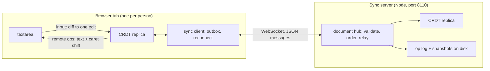

# Coedit

A real-time collaborative plain-text editor built on a hand-written sequence CRDT (RGA, the Replicated Growable
Array), in TypeScript: the CRDT, a WebSocket sync server (Node, `ws`) and a React client (Vite), as npm workspaces.

Several people edit one document at once, each in their own tab; edits merge without a central authority because
every replica applies the same commuting operations. Built to be explained end to end: one ordering rule with a short
proof, a strict wire format, and a test harness that is itself tested.

**Status: day 2 of 5.** Done: the design for all five days (DESIGN.md), the workspaces and CI, the wire format with a
strict decoder, the network simulator for convergence tests and its self-test, the client's mapping from textarea
input to edits (day 1), and the CRDT itself: RGA with Lamport ids, runs placed by the skip rule, tombstones,
operations in any order (waiting ones held and released), conflicts refused, positions as ids for presence, all
property-tested for convergence through the simulator and the real codec (day 2). Next: sync and presence over
WebSockets (day 3), persistence and tombstone collection (day 4), release (day 5).

## Architecture



The server orders operations into a numbered log and relays each to every client, the sender included (the echo is
the acknowledgement). It applies every operation to its own replica first, so it refuses what would split replicas
apart. Built so far: the wire format, the CRDT, the edit mapping, the server's health endpoint; the rest is specified
in DESIGN.md.

## Layout

| Path                            | What                                                                      |
| ------------------------------- | ------------------------------------------------------------------------- |
| `DESIGN.md`                     | the specification: RGA and why it converges, wire format, sync protocol   |
| `packages/crdt/src/rga.ts`      | the CRDT: insert, delete, waiting operations, conflicts, presence         |
| `packages/crdt/src/ids.ts`      | the id order (counter, then replica by code unit) and a map keyed by ids  |
| `packages/crdt/src/json.ts`     | a strict JSON reader (duplicate keys, lone surrogates, rounding: refused) |
| `packages/crdt/src/protocol.ts` | operations and protocol messages; strict decoder, canonical encoder       |
| `packages/crdt/test/harness/`   | the network simulator, the toy CRDTs that test it, the RGA as a subject   |
| `test/`                         | repo-wide checks: the docs against the code, the workspace exports        |
| `packages/crdt/scripts/`        | `harness-stats`, `bench-codec`, `deep-convergence`, `worst-delete`        |
| `packages/server/src/`          | the server: `/healthz` so far; `main.ts` is the command line              |
| `packages/client/src/edit.ts`   | textarea before/after + caret to one edit, in code points                 |
| `packages/client/src/App.tsx`   | the editor shell (local only until day 3)                                 |

## How to run

Node 22.18 or later: the TypeScript runs on Node's own type stripping, so nothing is compiled for the server, the
scripts or the tests (`tsc` only checks types).

```bash
npm ci
npm run check
```

`npm run check` runs the type checker, ESLint and Prettier, the tests (Node's built-in runner) and the client build;
CI runs the same steps on Node 22 and 24. The pieces:

```bash
npm start -w @coedit/server
```

```bash
npm run dev -w @coedit/client
```

The server listens on `127.0.0.1:8110` (`COEDIT_HOST`, `COEDIT_PORT`); `curl http://127.0.0.1:8110/healthz` gives
`{"status":"ok","protocol":1}`. The client is at `http://localhost:5173`; for now it edits a local document and shows
the edit each input became.

## Results (day 2)

Measured on the same Apple M3 (macOS 26.6.2, Node 23.11.0, on AC, no sleep in `pmset -g log`). All inputs are
synthetic.

- **Convergence at depth**: every convergence case passes at 20,000 schedules, by
  `npm run deep-convergence -w @coedit/crdt` at `a2ea2e7` (16:00 to 16:02, nothing else of mine running; macOS's
  `mediaanalysisd` was using a core). Its counts are fast-check's own. An earlier run of the same cases at `7b2e0d3`,
  by a one-off script with a review agent running alongside, gave the same within 0.3 s a case.

  | Case                                      | Seconds |
  | ----------------------------------------- | ------: |
  | 2 to 5 replicas, every freedom on         |     7.4 |
  | long schedules (80 steps), up to 6        |    49.0 |
  | causal delivery, no duplicates            |     8.3 |
  | clocks near 2^31                          |     6.6 |
  | clocks near 2^53 - 1 - 10,000             |     6.6 |
  | clocks far apart (0 to 2^53 - 1 - 10,000) |     9.9 |
  | all six                                   |    87.8 |

- **What the schedules exercise** (the coverage test in `packages/crdt/test/rga-convergence.test.ts`, 300 schedules,
  seed 1): an operation waited for a dependency in 61% of schedules (183), one delivery returned several changes
  (released waiting operations, or a scattered delete) in 51% (153), and 54% of deliveries (4,316 of 7,958) changed
  nothing (duplicates, echoes, waits). The test fails below about three quarters of each.
- **Every mechanism is load-bearing**: each one-line mutant of `rga.ts` and `ids.ts` run today (the skip rule removed
  or reversed, ties not broken by replica, `localeCompare` for the id order, the cascade of waiting runs dropped,
  either pre-delete path, the clocks' updates, the change index shift, the four conditions of the duplicate check,
  the splits and the clock's limit off by one, the presence methods counting tombstones) fails at least one test,
  most of them 3 to 7. Two guards failed none and were found to be unobservable (see the WALKTHROUGH); one was
  removed.
- **The worst delete** (`npm run worst-delete -w @coedit/crdt -- 1000 twice` at `a2ea2e7`): 10 million ids deleted
  ahead of their inserts from one 48,936-byte message, 3.6 s and +982 MiB of heap; a second such delete refused for
  the capacity in 1.1 s (the count of its ids), nothing changed. See "Limitations (day 2)".

## Results (day 1)

Measured on an Apple M3 (macOS 26.6.2, Node 23.11.0, on AC, awake throughout). All inputs are synthetic.

- **The simulator catches each broken toy CRDT within a few schedules**, and only with the freedom (or check) that
  exposes it (`npm run harness-stats -w @coedit/crdt -- 2000 200` at `102e41a`, and the same at `7ae190c`; schedules fast-check ran up to and
  including the first failure, over 200 seeds; every seed caught every toy):

  | Broken toy                           | Exposed by       | Median | p95 | Max |
  | ------------------------------------ | ---------------- | -----: | --: | --: |
  | edits by index                       | concurrent edits |      1 |   5 |   8 |
  | not idempotent                       | redelivery       |      2 |   4 |   8 |
  | not idempotent                       | echo to sender   |      1 |   2 |   5 |
  | drops a delete that arrives early    | reordering       |      2 |   6 |  11 |
  | removes a deleted character outright | the state check  |      1 |   3 |   8 |

- **What a default schedule contains** (same command, 2,000 samples), against the first generator, in which an edit
  was one of three equally likely steps at fast-check's default array size (measured by restoring it from a copy):

  |                                          |   First generator |  Now (`e96122f`) |
  | ---------------------------------------- | ----------------: | ---------------: |
  | edits per schedule                       |               1.3 |              5.3 |
  | of them concurrent with an earlier edit  |               0.4 |              3.8 |
  | schedules with a concurrent edit         |             25.6% |            71.3% |
  | redeliveries per schedule                |               0.3 |              2.0 |
  | early-delete toy: schedules until caught | median 13, max 96 | median 2, max 11 |

- **The strict decoder's cost** (`npm run bench-codec -w @coedit/crdt` at `e96122f`; median of 9 rounds of at least
  50 ms each, after warm-up):

  | Message                                    |     Bytes | `JSON.parse` | Strict reader | Full decode |   Encode |
  | ------------------------------------------ | --------: | -----------: | ------------: | ----------: | -------: |
  | one keystroke                              |       169 |      0.58 µs |       1.20 µs |     1.78 µs |  0.63 µs |
  | a paste: 100 inserts of 10,000 code points | 1,128,950 |       772 µs |      2,252 µs |    4,799 µs | 3,883 µs |
  | a delete of 1,000 spans                    |    62,890 |        95 µs |        414 µs |      566 µs |   174 µs |

  Before the profile-driven change in `5c6354f` the paste took 6,613 µs to decode and 5,231 µs to encode: a third of
  the time was the reader's character loop and a quarter was counting code points twice per insert.

- **Tests**: 138 in 31 suites, 3.9 s for the whole suite (`npm test`, at `d7eb9bb`); 2.6 s of it is the simulator's
  self-test, whose check that each step changed only its own replica snapshots every replica once a step (without
  snapshots it takes 0.4 s). The must-pass simulator properties also passed at 20,000 schedules each (a one-off run
  at `c1d40d0`, 0.3 to 2.4 s per case).

## Tests

- `packages/crdt/test/rga-convergence.test.ts`: RGA through the simulator with every freedom on, the real codec as
  the transport, the state check compulsory, the local model on, and every delivery's changes replayed; 2 to 5
  replicas, long schedules with up to 6, causal delivery, clocks near 2^31, near 2^53 and far apart; a coverage test
  pinning what the schedules exercise.
- `packages/crdt/test/rga-order.test.ts`: the sequence against an independent implementation of the spec (the origin
  tree, children largest first, in preorder) over 1,000 editing sessions in generated orders.
- `packages/crdt/test/rga.test.ts`: one behaviour at a time: local edits and their operations, remote operations and
  their visible changes, concurrent inserts at one spot, a larger insert's subtree skipped, inserts after tombstones,
  scattered deletes, duplicates and echoes, waiting chains, deletes ahead, refusals that change nothing, `state()`.
- `packages/crdt/test/rga-pending.test.ts`: over editing sessions with operations withheld, state and `pending` depend
  only on which operations arrived; `pending` matches a model; the rest delivered later converges.
- `packages/crdt/test/rga-conflicts.test.ts`: every way to reuse a known id is refused atomically, waiting runs
  included, and whether two inserts conflict doesn't depend on their order.
- `packages/crdt/test/rga-intention.test.ts`: concurrent typists at one spot keep their runs whole; backward typing's
  interleave pinned. `rga-presence.test.ts`: ids for cursors, round trips, a cursor following its text.
  `rga-limits.test.ts`: splitting long pastes and large deletes, the clock's end. `ids.test.ts`: the id order.
- `packages/crdt/test/json.test.ts`: the reader against `JSON.parse` (random values at any indentation; 20,000 random
  texts over JSON's alphabet, both surrogate halves included), every refusal, long strings either side of the scan
  window, a million-deep nesting attempt.
- `packages/crdt/test/protocol.test.ts`: round trips for every message kind with counters near both ends of the range;
  key order and whitespace not mattering; 5,000 randomly edited texts each refused or round-tripping; each refusal with
  its exact path; the encoder refusing NaN, -0, lone surrogates and extra keys.
- `packages/crdt/test/harness.test.ts`: the simulator's self-test in both directions (a correct toy passes; four broken
  ones fail only with the freedom that exposes them), shrinking on fixed seeds, replay.
- `packages/crdt/test/harness-mechanics.test.ts`: each delivery mechanism on hand-written schedules (picks, flush
  order, redelivery, echo, every replica compared, a sender's later changes not reaching the network, a step that
  changes a bystander, the `state()` opt-in, the transport).
- `packages/crdt/test/harness-coverage.test.ts`: what 2,000 default schedules contain (replica counts, lengths, every
  alphabet unit and edit size, positions at the start, middle and end of real text).
- `packages/client/test/edit.test.ts`: any caret gives a correct edit; minimal without a caret; a random edit with the
  browser's caret comes back exactly; UTF-16/code-point conversion at every boundary.
- `packages/server/test/`: health, HEAD, 405, 404, the default bind address, a taken port, close mid-request, port
  parsing; `main.test.ts` runs the command line as a child process (signals, exit codes, IPv6).
- `test/docs.test.ts` (parsing in `test/docs.ts`): every npm script, workspace, repo path and `:line` the docs name
  exists, and the ports and response they quote are the code's; the parser is also tested on twelve bad fragments.
  `test/exports.test.ts`: every workspace export imports.
- `review1-*.test.ts`, `review2-*.test.ts`: the reviews' findings, each of which failed before its fix.

## Review of day 2

One review agent at a time, each in its own worktree with a correctness brief, writing each finding as a failing test
(`packages/crdt/test/review1-rga.test.ts` holds them).

**Round 1** (at `0cbad60`, the core with its tests; 14 minutes) reproduced 3 defects and one rule that was too broad:

1. **`pending` depended on arrival order**: only the first delete naming a missing id waited for it, so two deletes
   naming the same missing id counted as one or two. I had found and fixed it meanwhile (`63e271a`, with
   `rga-pending.test.ts`); the review's honest-replica case is kept as a test.
2. **Releasing about 110,000 runs waiting on one element overflowed the stack** (`queue.push(...waiting)`) after the
   releasing insert was placed and the runs taken out of the waiting map: they were lost for good (known, so a resend
   was a duplicate; never placed; not pending). `state()` spread the same list. Both push one at a time; an ESLint
   rule forbids spreading into `push` in the CRDT; the test runs the fan-out in a child process with a 100 KB stack,
   where the old code overflowed at 20,000 runs (`584a0fd`).
3. **`edit()` returned the origin element's own id object** as the insert's origin, so changing the returned operation
   renamed an element inside the replica. Fixed with a copy, and a property that changes every field of every
   returned operation (`d2eaeab`).
4. **The clock moved for every span of every delete**, so one delete naming 2^53 - 1 of any replica stopped this
   replica's inserts for good. Only spans under the replica's own id need to (`410c093`).

Of its mutants, 4 survived the tests at `0cbad60`: `length` counting elements deleted ahead and `state()` listing
waiting runs in arrival order (both caught by `rga-pending.test.ts` by then, and pinned directly in `55dec77`), the
delete's clock update applied to the first span only (pinned in `410c093`), and releasing waiting runs in reverse
order, which is harmless (the changes are still a valid sequence). Five more were equivalent. Its census of 3,000
schedules (seed 7) showed what the convergence generator reaches: an insert waiting for its origin in 52.1% of
schedules, a chain of two or more waiting runs in 9.7%, a delete naming an id another delete already waits for in
17.7%, a delete of an element in a waiting run in 14.6%, a duplicate of a waiting run in 7.4%; and what it never
makes: conflicts, forged ids, a fan-out large enough for finding 2, or dependencies that never arrive (which
`rga-pending.test.ts` covers by withholding operations).

## Review of day 1

Two review agents, one after the other, each in its own worktree with a correctness brief, writing each finding as a
failing test.

**Round 1** (at `e688359`, 12 minutes) found 8 defects:

1. **The simulator handed every replica the same operation object.** A toy that never applies a remote delete, and
   instead flags the element object it keeps (the received operation itself), passed 2,000 schedules: the flag
   travelled through the shared object. Fixed with a copy at send and at each delivery (`0023578`); a test for each.
2. The final flush was a random order only for its first 10 or so deliveries (fast-check's default size), oldest-first
   after that (`36dd34e`).
3. The index toy could diverge with no concurrency (an edit's delete and insert arrived reordered), contradicting its
   own comment; one operation per edit now (`0023578`).
4. The shrink-length test ran unseeded and failed on about 1.5% of seeds (`36dd34e`).
5. `diffText`'s comment and DESIGN were wrong: the caret can make the edit bigger than the smallest (it is then the
   edit that was typed). Docs fixed, behaviour pinned (`14efa2e`).
6. A NaN or fractional caret threw (`14efa2e`).
7. The encoder could be made to write what the decoder refuses, through an Array subclass with `toJSON` or an array
   with its own `map` (`02940be`).
8. `startServer({ host: '' })` listened on every interface (`43926d7`; `main.ts` already refused it since `119233c`).

It also listed about 15 mutations no test caught. Most weakened the schedule generator (2 replicas, edits only at
position 0, one-letter inserts...), which the self-test can't see because weak schedules still catch the broken toys;
`harness-coverage.test.ts` and `harness-mechanics.test.ts` pin them now. Every listed survivor was re-run here as a
mutant afterwards and fails a test.

**Round 2** (on everything since `e688359`, round 1's fixes included; 11 minutes) found 4 more, two of them in round
1's fixes:

1. **The array copy of `02940be` read the length live**, so an array whose index getter appends to it grew past the
   1,000-item limit while being copied (`f364ec0`).
2. **Replicas could still share state another way**: a toy keeping elements in a cache common to all replicas (a
   static Map of nodes) passed 2,000 schedules. The simulator now checks that a local edit changes only its own
   replica and a delivery only its target (`de9e787`; halved in cost in `d7eb9bb`). Also from it: `state()` all or
   none, a `requireState` option, a pluggable transport.
3. The docs test missed seven forms of command and path, each now tested (`d12991c`).
4. A failing server test hung the suite and left `main.ts` listening; children are now killed in cleanup and `npm
test` has a per-test timeout (`c646344`).

Its eleven surviving mutants (the control-character range edges, three of them; the skip-count bound; edits only by
replicas 0 and 1; the alphabet constant, two ways; redelivery of the last message; `state()` skipped when one replica
lacks it; a rounded caret; the IPv6 bind message) were each
re-run here after the new tests: all fail a test.

I found one more myself: the per-delivery copies broke `harness-stats`' counting, which recognised operations by
identity (0.0 redeliveries; echoes counted as receipts); fixed in `102e41a`, and every number above re-measured after
it.

## Design decisions

The full reasoning is in DESIGN.md ("Decisions"). In short: a CRDT rather than OT (no central transform); RGA for its
one rule and short proof; code points as elements; any delivery order, with pending operations instead of causal
delivery; a strict reader because `JSON.parse` lets two replicas read one message differently; the server's echo as
the acknowledgement; Node's type stripping and test runner rather than a build step (and Vitest 5 and ESLint 10 don't
support this machine's Node 23).

## Limitations (day 2)

- Sync, presence over the network and persistence don't exist yet; the client edits locally (day 3 and 4).
- Every operation scans one array: O(n) in the document's elements, tombstones included, and tombstones are never
  collected yet. Day 4 measures it and collects what it can prove unneeded.
- **One valid delete can name 10 million ids** (1,000 spans of 10,000), and a replica holding none of them records
  each as deleted ahead: 3.6 s and +982 MiB of heap for one 48,936-byte message (0.16 s and +82 MiB for 100 spans,
  4,836 bytes), measured with `npm run worst-delete -w @coedit/crdt` (add `-- 100` for 100 spans). In
  Coedit's topology clients only receive what the server accepted, and the server (day 3) must refuse operations whose
  dependencies it lacks, checking spans against runs rather than id by id. Storing absent ids as spans would fix it in
  the CRDT itself. A second such delete would pass the replica's capacity (2^24 - 1 ids deleted ahead, the most a V8
  Map holds) and is refused before anything changes; before review 2 it overflowed a Map halfway.
- Which of two conflicting inserts a replica keeps depends on which arrived first; that the pair conflicts doesn't. The
  server settles it by refusing the second (day 3).
- A peer can exhaust a replica's clock with an insert at counter 2^53 - 1, or a delete naming this replica's own id
  at 2^53 - 1 (a delete naming another replica's ids no longer moves the clock, since review 1); edits that need ids
  are then refused. Only a buggy or tampered peer can, and the server will have to refuse such counters.
- Text typed backwards at one spot interleaves with concurrent text typed the same way (RGA's known weakness, pinned
  by a test); grapheme clusters can be split by concurrent edits (code points can't).

## Limitations (day 1)

- The CRDT, sync, presence and persistence don't exist yet; the client edits locally.
- The server has no authentication: it binds 127.0.0.1 and will trust that clients are who they say.
- CI hasn't run yet: the GitHub repository couldn't be created this session. The whole check passes in a clean clone
  with `npm ci` on Node 23; Node 22 and 24, which CI uses, are not installed here.
- The simulator's convergence check can't catch an id comparison that is wrong only across machines (such as
  `localeCompare`): within one process a comparator used consistently converges. Day 2 tests the id order directly.
- Its default transport (`structuredClone`) keeps Maps, BigInts and -0, which JSON on the wire wouldn't; day 2 should
  pass the real codec as the transport.
- Measurements are from one laptop; the decode numbers are single-threaded microbenchmarks on synthetic messages.

## License

MIT
