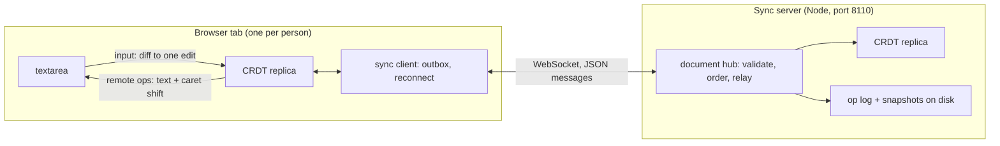

# Coedit

A real-time collaborative plain-text editor built on a hand-written sequence CRDT (RGA, the Replicated Growable
Array), in TypeScript: the CRDT, a WebSocket sync server (Node, `ws`) and a React client (Vite), as npm workspaces.

Several people edit one document at once, each in their own tab; edits merge without a central authority because
every replica applies the same commuting operations. Built to be explained end to end: one ordering rule with a short
proof, a strict wire format, and a test harness that is itself tested.

**Status: v1.0.0** (day 5 of 5; what's in it: CHANGELOG.md). Built a day at a time: the design, the wire format with a
strict decoder, and a network simulator for convergence tests that is itself tested (day 1); the CRDT: RGA with
Lamport ids, runs placed by the skip rule, tombstones, operations in any order, conflicts refused, positions as ids
for presence, property-tested for convergence (day 2); sync: one hub per document on a WebSocket server (a numbered
log, the echo as acknowledgement, refusing what it can't place), the sync client (an outbox, catch-up then resend,
backoff), the React editor patching remote changes into the textarea with the caret kept in place, remote cursors and
offline editing, convergence tested end to end on the real server (day 3); persistence: an op log fsynced before
anything is relayed, snapshots that are ordinary operations, crash recovery; Playwright with two browsers; the
measurements and, from them, counted blocks instead of one scanned array (about 175 times faster at 369,000
elements); and tombstone collection by the leaf rule, with clients rebuilding from snapshots (day 4); the release
review, the results at v1.0.0 and the final docs (day 5). Every day ended with a review by a separate agent that wrote
each finding as a failing test before it was fixed.

## Architecture



The server orders operations into a numbered log and relays each to every client, the sender included (the echo is
the acknowledgement). It applies every operation to its own replica first, so it refuses what would split replicas
apart, and it accepts only operations whose dependencies it has placed, so its log is in causal order. Each document's
log and snapshots are on disk (one directory per document); an entry is written before anyone sees it, so a restart
or a crash never leaves a client ahead of the server.

## Layout

| Path                              | What                                                                             |
| --------------------------------- | -------------------------------------------------------------------------------- |
| `DESIGN.md`                       | the specification: RGA and why it converges, wire format, sync protocol          |
| `WALKTHROUGH.md`                  | the questions an interviewer is likely to ask, answered from the code            |
| `CHANGELOG.md`                    | what v1.0.0 holds                                                                |
| `packages/crdt/src/rga.ts`        | the CRDT: insert, delete, waiting operations, conflicts, presence                |
| `packages/crdt/src/ids.ts`        | the id order (counter, then replica by code unit) and a map keyed by ids         |
| `packages/crdt/src/json.ts`       | a strict JSON reader (duplicate keys, lone surrogates, rounding: refused)        |
| `packages/crdt/src/protocol.ts`   | operations and protocol messages; strict decoder, canonical encoder              |
| `packages/crdt/test/harness/`     | the network simulator, the toy CRDTs that test it, the RGA as a subject          |
| `test/`                           | repo-wide checks: the docs against the code, the workspace exports               |
| `packages/crdt/scripts/`          | `harness-stats`, `bench-codec`, `deep-convergence`, `worst-delete`, `editing`    |
| `packages/server/src/hub.ts`      | one document: the server's replica, the numbered log, members, presence          |
| `packages/server/src/store.ts`    | a document on disk: log segments, snapshots, recovery from a crash               |
| `packages/server/scripts/`        | `storage`: append cost with and without fsync, load from log and snapshot        |
| `packages/client/e2e/`            | Playwright: two browsers editing one document, offline and back                  |
| `packages/server/src/server.ts`   | HTTP (`/healthz`) and the `/sync` WebSocket: sessions, origins, heartbeat        |
| `packages/server/src/main.ts`     | the command line (`COEDIT_HOST`, `COEDIT_PORT`, `COEDIT_ORIGINS`, `COEDIT_DATA`) |
| `packages/client/src/sync.ts`     | the sync client: replica, outbox, echo matching, reconnect, presence             |
| `packages/client/src/edit.ts`     | textarea before/after + caret to one edit, in code points                        |
| `packages/client/src/textarea.ts` | remote changes applied to the textarea's text and selection                      |
| `packages/client/src/App.tsx`     | the editor: textarea, remote cursors, status, offline switch                     |
| `packages/client/scripts/`        | `sync-latency`: edit to acknowledgement and to other clients, loopback           |

## How to run

Node 22.18 or later: the TypeScript runs on Node's own type stripping, so nothing is compiled for the server, the
scripts or the tests (`tsc` only checks types).

```bash
npm ci
npm run check
```

`npm run check` runs the type checker, ESLint and Prettier, the tests (Node's built-in runner) and the client build;
CI runs the same steps on Node 22 and 24. The pieces:

```bash
npm start -w @coedit/server
```

```bash
npm run dev -w @coedit/client
```

The server listens on `127.0.0.1:8110` (`COEDIT_HOST`, `COEDIT_PORT`); `curl http://127.0.0.1:8110/healthz` gives
`{"status":"ok","protocol":1}`. Pages may connect from the client's dev server only; `COEDIT_ORIGINS` (origins
separated by commas) sets which. The client is at `http://localhost:5173`: open `http://localhost:5173/?doc=demo` in
two tabs (or two browsers) and type in both. The dev server passes `/sync` on to the sync server
(`COEDIT_SYNC_TARGET`, default `ws://127.0.0.1:8110`). "Go offline" closes the connection: edits made meanwhile wait
in the outbox and merge when it's pressed again. Each tab is a new replica, so a reload starts from the server's log
(edits not yet acknowledged are lost with the tab).

Documents are kept in `COEDIT_DATA` (default `data` in the server's working directory, which for the command above is
`packages/server/`, gitignored): stop the server, start it again, and the tabs reconnect where they were. The
end-to-end tests start both servers themselves, on the same ports (so stop yours first), and drive the installed
Chrome:

```bash
npm run e2e -w @coedit/client
```

The day-4 measurements:

```bash
npm run editing -w @coedit/crdt
```

```bash
npm run storage -w @coedit/server
```

## Results at v1.0.0

Measured at `ec83d37` (the release code before day 5's review fixes) on the Apple M3 (macOS 26.6.2, Node 23.11.0),
**on battery** (54%), 15:02 to 15:04 on day 5 with nothing else of mine running. The editing session is synthetic (a
seeded random model of typing, the same 100,000 edits as on day 4); everything runs over loopback. Each line names
the command that printed it; the day sections below have the before/after numbers and how they were reached.

| What                                                       | Result                                                               | Command                                  |
| ---------------------------------------------------------- | -------------------------------------------------------------------- | ---------------------------------------- |
| Local typing, last tenth of the session (369,000 elements) | 262,273 edits/s (first tenth 235,845)                                | `npm run editing -w @coedit/crdt`        |
| A second replica applying all 95,043 operations            | 356,873 ops/s; 195,649/s from JSON text through the strict decoder   | `npm run editing -w @coedit/crdt`        |
| A 100,000-character paste into the middle                  | 14.4 ms local, 14.0 ms remote (10 operations)                        | `npm run editing -w @coedit/crdt`        |
| Tombstones at the end of the session                       | 45.3% of 468,852 elements                                            | `npm run editing -w @coedit/crdt`        |
| Tombstone collection (leaf rule, every delete old enough)  | 35,414 of 112,386 (31.5%) in 40 ms; snapshot 10,231,290 to 7,168,496 | `npm run editing -w @coedit/crdt`        |
| Heap of a replica rebuilt from a snapshot                  | 229 bytes per element                                                | `npm run editing -w @coedit/crdt`        |
| Durable appends (fsync every message)                      | 349 and 338 messages/s; submit p50 2.97 ms, p99 4.34 and 4.04 ms     | `npm run storage -w @coedit/server`      |
| Appends without fsync                                      | 110,374 and 115,950 messages/s (in memory only: 77,210 and 83,367)   | `npm run storage -w @coedit/server`      |
| Opening a 100,000-entry document from its log              | 484 and 473 ms                                                       | `npm run storage -w @coedit/server`      |
| Writing its snapshot (with fsync)                          | 125 and 120 ms, 7,830,313 bytes                                      | `npm run storage -w @coedit/server`      |
| Opening it from the snapshot                               | 291 and 288 ms                                                       | `npm run storage -w @coedit/server`      |
| Edit to acknowledgement (1 writer, 3 readers, every 5 ms)  | p50 3.71 and 3.72 ms, p99 5.52 and 5.24 ms                           | `npm run sync-latency -w @coedit/client` |
| Edit to each other client                                  | p50 3.87 and 3.82 ms, p99 6.00 and 5.79 ms                           | `npm run sync-latency -w @coedit/client` |
| Tests                                                      | 503, all passing, 18 s                                               | `npm test`                               |

Where two numbers are given the command was run twice. The storage script always runs the in-memory hub first, and
both times it came out slower than the store without fsync; read the two as equal (the difference is under 0.01 ms a
message) and both as far above the fsync row. Since day 4 (`077d156`) the latency script gives its server a data
directory, so each edit waits for an fsync before it is relayed; it wasn't re-measured on day 4, and on day 3, with
nothing on disk, the acknowledgement's p50 was 0.56 ms. The difference, about 3 ms, is the storage script's fsync p50:
`F_FULLFSYNC` on this Mac (see "Durable acknowledgements" under Limitations). The storage script's snapshot is 18.5%
smaller than day 4's 9,609,593 bytes because the server now collects what it can when it writes one.

## Results (day 4)

Measured on the Apple M3 (macOS 26.6.2, Node 23.11.0), **on battery** (44% at 15:01, 33% at 15:31), nothing else of
mine running unless said. The editing session is synthetic (a seeded random model of typing, not a recorded trace).

- **The CRDT over a 100,000-edit session** (`npm run editing -w @coedit/crdt`, seed 1): 70,294 characters typed,
  14,935 backspaces, 4,957 caret moves, 3,801 selections deleted, 1,021 pastes of 20 to 500 characters, 4,992 words;
  95,043 operations. Run first with the elements in one array scanned from the start (at `97e88cd`, 129.7 s in all),
  then with blocks of 512 elements that count their visible ones (at `8e8f5cf`, 2.7 s in all); same seed, same
  session (the growth numbers below came out identical):

  | Tenth of the session | Local edits/s, one array | Local edits/s, blocks | Visible at its end | Elements at its end |
  | -------------------: | -----------------------: | --------------------: | -----------------: | ------------------: |
  |                    1 |                   21,357 |               237,240 |             32,709 |              43,540 |
  |                    3 |                    5,408 |               333,421 |             79,872 |             113,250 |
  |                    5 |                    3,093 |               323,474 |            133,000 |             188,817 |
  |                    7 |                    2,051 |               289,882 |            183,101 |             261,989 |
  |                   10 |                    1,462 |               256,670 |            256,466 |             368,852 |

  With one array the rate fell with the document's size (tombstones included); with blocks it stays flat. A second
  replica applying all 95,043 operations in order: 3,338 a second (28.5 s) with one array, 374,736 (254 ms) with
  blocks; from JSON text through the strict decoder, 3,425 and 199,664 a second (so with blocks the decoder is about
  half the cost). A 100,000-character paste into the middle: 20.5 ms locally and 24.0 ms remotely before, 16.9 and 12.3
  ms after (10 operations). At the end (the paste deleted again): 256,466 visible characters, 468,852 elements, **45.3%
  tombstones**; a snapshot of 10,333,000 bytes (40.3 per visible character, 76,336 operations) against a session log
  of 12,777,386 (49.8). A replica rebuilt from the snapshot takes 212 bytes of heap per element with blocks (the mean of
  three kept at once; the first version of the script measured one copy and printed a negative size at 100,000 edits,
  fixed in `f89e5c0`). At 20,000 edits (`npm run editing -w @coedit/crdt -- 20000`, one array): 50,240 edits/s in the
  first tenth falling to 8,006, 69.4% tombstones, 186 bytes of heap per element.

- **What storage costs** (`npm run storage -w @coedit/server`, at `477dd82`'s script, its first run): 2,000
  one-character messages submitted one after another:

  | Hub                       | Messages/s | submit p50 | submit p99 | max (ms) |
  | ------------------------- | ---------: | ---------: | ---------: | -------: |
  | in memory only            |     92,509 |   0.004 ms |   0.013 ms |     0.30 |
  | store, no fsync           |     78,051 |   0.006 ms |   0.014 ms |     0.25 |
  | store, fsync each message |        337 |   2.965 ms |   4.041 ms |     26.7 |

  On macOS Node's fsync is `F_FULLFSYNC` (it waits for the drive), so durable acknowledgements cap one server at
  about 340 messages a second; group commit would lift that (not built). A document of 100,000 log entries (11,964,458
  bytes; one-character inserts, every sixth entry a backspace), three runs:

  | Code                                        | Open from the log | Write a snapshot | Open from the snapshot |
  | ------------------------------------------- | ----------------: | ---------------: | ---------------------: |
  | one array (`477dd82`)                       |          7,235 ms |           143 ms |               6,137 ms |
  | blocks, sequence-order snapshot (`8e8f5cf`) |            467 ms |           109 ms |               2,350 ms |
  | blocks, id-order snapshot (`6da3de0`)       |            481 ms |           115 ms |                 344 ms |

  With one array each run's placement scanned from the start, so loading was O(n) done n times either way. With
  blocks the log loads in under half a second, but the first snapshot order (each run where its first element sits
  in the sequence) was five times slower than the log: a tombstone typed early sits after everything typed after it
  at its spot, and placing it scanned past all of that. Runs in id order stop just after their origin. The snapshot
  file is 9,609,593 bytes. Loading still blocks the server's event loop while it runs.

- **Two browsers** (`npm run e2e -w @coedit/client`): 4 Playwright tests, 4.6 s here; CI runs them in a job of their
  own on the runner's Chrome.
- **A SIGKILL while a client types** (`packages/server/test/crash.test.ts`): three rounds of 300 characters sent one
  a message, the server killed after 100 echoes and started again on the same directory; every round the restarted
  log held at least every echoed entry, and the next round's reader found the log exactly a prefix of what was typed.
- **Tombstone collection** (`npm run editing -w @coedit/crdt`, the same session, at `2a26ec5`; a server's replica
  with every delete old enough): the leaf rule takes 35,414 of 112,386 tombstones (31.5%) in 28 to 33 ms (two runs),
  368,852 elements to 333,438, kept as 8,809 collected spans; the snapshot goes from 10,231,290 bytes to 7,168,496. A
  replica rebuilt from the snapshot takes 229 bytes of heap an element against 212 before the collection's bookkeeping
  (237 with a flag it turned out not to need), so the heap falls only about 2% (333,438 x 229 against 368,852 x 212).
  On the real server with a snapshot every 3 entries, the convergence property ran 60 documents four times: 35 to 41
  collected something, 79 to 96 clients ended rebuilt from a snapshot, and every one converged.
- **Tests**: 382 at the start of the day (`6484624`, `npm test`), 443 at `477dd82`, 494 at `2a26ec5`.

## Results (day 3)

Measured on the Apple M3 (macOS 26.6.2, Node 23.11.0), **on battery** (46% at the start of the session, 26% by
22:44), no sleep in `pmset -g log` during the session and none during each latency run (the script checks). All
inputs are synthetic; everything runs over loopback.

- **Edit to acknowledgement and to the other clients** (`npm run sync-latency -w @coedit/client`): a writer types one
  character every 5 ms at the end of the text, 2,000 edits of which the first 200 are a warm-up, paced by the clock;
  the server is its own process; the writer and the readers share one process. Nearest-rank percentiles, in
  milliseconds. The first three rows at `4214531` with the first review agent running tests alongside; the last two at
  `3a56512` with nothing of mine running (VLC was using about a fifth of a core); they agree:

  | Readers | Run              | ack p50 | ack p99 | ack max | remote p50 | remote p95 | remote p99 | remote max |
  | ------: | ---------------- | ------: | ------: | ------: | ---------: | ---------: | ---------: | ---------: |
  |       3 | 1 (review on)    |    0.56 |    1.94 |    5.19 |       0.77 |       1.57 |       2.48 |       6.02 |
  |       3 | 2 (review on)    |    0.55 |    2.19 |   13.32 |       0.75 |       1.44 |       2.71 |      13.59 |
  |      10 | 1 (review on)    |    0.54 |    1.86 |    4.58 |       1.00 |       2.05 |       3.26 |       8.22 |
  |       3 | 3 (nothing else) |    0.57 |    1.90 |   36.68 |       0.78 |       1.53 |       2.43 |      36.88 |
  |      10 | 2 (nothing else) |    0.54 |    2.10 |    5.39 |       1.02 |       2.13 |       3.26 |       6.02 |

  "remote" counts each reader's copy (5,400 and 18,000 samples). A round trip through the server costs about half a
  millisecond here; network latency would dominate any real deployment.

- **Convergence end to end** (`packages/client/test/sync-convergence.test.ts`, 100 generated schedules on the real
  server, about 4 s): five runs made 1,012 to 1,134 edits and 153 to 179 dropped connections each, plus offline
  spells; every schedule ended with every client's replica state equal to the server's. The test fails below 700
  edits or 100 drops.
- **Checking the largest delete** (`Rga.ready`, run by run): 1,000 lookups for 1,000 spans of 10,000 ids over one
  run, counted in `rga-ready.test.ts`; an id-by-id version took about 110 ms for the same delete.
- **One message of overlapping deletes** (the review's case, `review-d3-overlap-dos.test.ts`): before the fix it kept
  the event loop busy 5.3 to 5.5 s in the review's runs and 12.9 s in mine on battery; now its first delete is
  refused at once.
- **A long catch-up** (`review-d3-catchup-drop.test.ts`): a fresh client joining a document whose log is about 32
  MiB (801 entries), with the slow-reader limit at 256 KiB, now receives all of it (the test, which builds the log
  first, takes about 3 s); before the fix it received nothing and was dropped on every attempt.
- **Tests**: 252 at the start of the day (`c60a050`), 382 at `3a56512` (`npm test`); CI green on Node 22 and 24.

## Results (day 2)

Measured on the same Apple M3 (macOS 26.6.2, Node 23.11.0, on AC, no sleep in `pmset -g log`). All inputs are
synthetic.

- **Convergence at depth**: every convergence case passes at 20,000 schedules, by
  `npm run deep-convergence -w @coedit/crdt` at `a2ea2e7` (16:00 to 16:02, nothing else of mine running; macOS's
  `mediaanalysisd` was using a core). Its counts are fast-check's own. An earlier run of the same cases at `7b2e0d3`,
  by a one-off script with a review agent running alongside, gave the same within 0.3 s a case.

  | Case                                      | Seconds |
  | ----------------------------------------- | ------: |
  | 2 to 5 replicas, every freedom on         |     7.4 |
  | long schedules (80 steps), up to 6        |    49.0 |
  | causal delivery, no duplicates            |     8.3 |
  | clocks near 2^31                          |     6.6 |
  | clocks near 2^53 - 1 - 10,000             |     6.6 |
  | clocks far apart (0 to 2^53 - 1 - 10,000) |     9.9 |
  | all six                                   |    87.8 |

- **What the schedules exercise** (the coverage test in `packages/crdt/test/rga-convergence.test.ts`, 300 schedules,
  seed 1): an operation waited for a dependency in 61% of schedules (183), one delivery returned several changes
  (released waiting operations, or a scattered delete) in 51% (153), and 54% of deliveries (4,316 of 7,958) changed
  nothing (duplicates, echoes, waits). The test fails below about three quarters of each.
- **Every mechanism is load-bearing**: each one-line mutant of `rga.ts` and `ids.ts` run today (the skip rule removed
  or reversed, ties not broken by replica, `localeCompare` for the id order, the cascade of waiting runs dropped,
  either pre-delete path, the clocks' updates, the change index shift, the four conditions of the duplicate check,
  the splits and the clock's limit off by one, the presence methods counting tombstones) fails at least one test,
  most of them 3 to 7. Two guards failed none and were found to be unobservable (see the WALKTHROUGH); one was
  removed.
- **The worst delete** (`npm run worst-delete -w @coedit/crdt` at `617d125`): the wire format's largest, 10 million
  absent ids in a 48,936-byte message, is refused for the capacity in 69 ms, nothing changed. With `-- 800 twice`: 8
  million ids deleted ahead from a 39,136-byte message, 2.4 s and +651 MiB of heap, and a second such delete refused
  in 1.1 s (the count of its ids); review 4's runs of the same gave 2.2 s and 1.0 s. See "Limitations".

## Results (day 1)

Measured on an Apple M3 (macOS 26.6.2, Node 23.11.0, on AC, awake throughout). All inputs are synthetic.

- **The simulator catches each broken toy CRDT within a few schedules**, and only with the freedom (or check) that
  exposes it (`npm run harness-stats -w @coedit/crdt -- 2000 200` at `102e41a`, and the same at `7ae190c`; schedules fast-check ran up to and
  including the first failure, over 200 seeds; every seed caught every toy):

  | Broken toy                           | Exposed by       | Median | p95 | Max |
  | ------------------------------------ | ---------------- | -----: | --: | --: |
  | edits by index                       | concurrent edits |      1 |   5 |   8 |
  | not idempotent                       | redelivery       |      2 |   4 |   8 |
  | not idempotent                       | echo to sender   |      1 |   2 |   5 |
  | drops a delete that arrives early    | reordering       |      2 |   6 |  11 |
  | removes a deleted character outright | the state check  |      1 |   3 |   8 |

- **What a default schedule contains** (same command, 2,000 samples), against the first generator, in which an edit
  was one of three equally likely steps at fast-check's default array size (measured by restoring it from a copy):

  |                                          |   First generator |  Now (`e96122f`) |
  | ---------------------------------------- | ----------------: | ---------------: |
  | edits per schedule                       |               1.3 |              5.3 |
  | of them concurrent with an earlier edit  |               0.4 |              3.8 |
  | schedules with a concurrent edit         |             25.6% |            71.3% |
  | redeliveries per schedule                |               0.3 |              2.0 |
  | early-delete toy: schedules until caught | median 13, max 96 | median 2, max 11 |

- **The strict decoder's cost** (`npm run bench-codec -w @coedit/crdt` at `e96122f`; median of 9 rounds of at least
  50 ms each, after warm-up):

  | Message                                    |     Bytes | `JSON.parse` | Strict reader | Full decode |   Encode |
  | ------------------------------------------ | --------: | -----------: | ------------: | ----------: | -------: |
  | one keystroke                              |       169 |      0.58 µs |       1.20 µs |     1.78 µs |  0.63 µs |
  | a paste: 100 inserts of 10,000 code points | 1,128,950 |       772 µs |      2,252 µs |    4,799 µs | 3,883 µs |
  | a delete of 1,000 spans                    |    62,890 |        95 µs |        414 µs |      566 µs |   174 µs |

  Before the profile-driven change in `5c6354f` the paste took 6,613 µs to decode and 5,231 µs to encode: a third of
  the time was the reader's character loop and a quarter was counting code points twice per insert.

- **Tests**: 138 in 31 suites, 3.9 s for the whole suite (`npm test`, at `d7eb9bb`); 2.6 s of it is the simulator's
  self-test, whose check that each step changed only its own replica snapshots every replica once a step (without
  snapshots it takes 0.4 s). The must-pass simulator properties also passed at 20,000 schedules each (a one-off run
  at `c1d40d0`, 0.3 to 2.4 s per case).

## Tests

`npm test` runs 504 tests in 98 suites in about 18 s (Node's runner, files in parallel), and
`npm run e2e -w @coedit/client` runs the 4 Playwright tests; CI runs both on every push (the suite on Node 22 and
24). By file:

- `packages/crdt/test/rga-convergence.test.ts`: RGA through the simulator with every freedom on, the real codec as
  the transport, the state check compulsory, the local model on, and every delivery's changes replayed; 2 to 5
  replicas, long schedules with up to 6, causal delivery, clocks near 2^31, near 2^53 and far apart; a coverage test
  pinning what the schedules exercise.
- `packages/crdt/test/rga-order.test.ts`: the sequence against an independent implementation of the spec (the origin
  tree, children largest first, in preorder) over 1,000 editing sessions in generated orders.
- `packages/crdt/test/rga.test.ts`: one behaviour at a time: local edits and their operations, remote operations and
  their visible changes, concurrent inserts at one spot, a larger insert's subtree skipped, inserts after tombstones,
  scattered deletes, duplicates and echoes, waiting chains, deletes ahead, refusals that change nothing, `state()`.
- `packages/crdt/test/rga-pending.test.ts`: over editing sessions with operations withheld, state and `pending` depend
  only on which operations arrived; `pending` matches a model; the rest delivered later converges.
- `packages/crdt/test/rga-conflicts.test.ts`: every way to reuse a known id is refused atomically, waiting runs
  included, and whether two inserts conflict doesn't depend on their order.
- `packages/crdt/test/rga-intention.test.ts`: concurrent typists at one spot keep their runs whole; backward typing's
  interleave pinned. `rga-presence.test.ts`: ids for cursors, round trips, a cursor following its text.
  `rga-limits.test.ts`: splitting long pastes and large deletes, the clock's end. `ids.test.ts`: the id order.
- `packages/crdt/test/json.test.ts`: the reader against `JSON.parse` (random values at any indentation; 20,000 random
  texts over JSON's alphabet, both surrogate halves included), every refusal, long strings either side of the scan
  window, a million-deep nesting attempt.
- `packages/crdt/test/protocol.test.ts`: round trips for every message kind with counters near both ends of the range;
  key order and whitespace not mattering; 5,000 randomly edited texts each refused or round-tripping; each refusal with
  its exact path; the encoder refusing NaN, -0, lone surrogates and extra keys.
- `packages/crdt/test/harness.test.ts`: the simulator's self-test in both directions (a correct toy passes; four broken
  ones fail only with the freedom that exposes them), shrinking on fixed seeds, replay.
- `packages/crdt/test/harness-mechanics.test.ts`: each delivery mechanism on hand-written schedules (picks, flush
  order, redelivery, echo, every replica compared, a sender's later changes not reaching the network, a step that
  changes a bystander, the `state()` opt-in, the transport).
- `packages/crdt/test/harness-coverage.test.ts`: what 2,000 default schedules contain (replica counts, lengths, every
  alphabet unit and edit size, positions at the start, middle and end of real text).
- `packages/client/test/edit.test.ts`: any caret gives a correct edit; minimal without a caret; a random edit with the
  browser's caret comes back exactly; UTF-16/code-point conversion at every boundary.
- `packages/server/test/`: health, HEAD, 405, 404, the default bind address, a taken port, close mid-request, port
  parsing; `main.test.ts` runs the command line as a child process (signals, exit codes, IPv6, `COEDIT_ORIGINS`);
  `signal-order.test.ts` checks, from inside the child, that the signal handlers exist when "listening" is printed.
- `packages/server/test/hub.test.ts` (day 3): the document hub without sockets: numbering and relay, catch-up from any
  `have` in batches, `ahead-of-server`, replacement, a resent insert not logged and a resent delete logged, each
  refusal (origin missing, delete naming a missing id, a reused id, counters past the clock, a full document) leaving
  the server's state byte for byte as it was, the clock argument run to the end with a capacity of 1,000, presence.
- `packages/server/test/sync.test.ts` (day 3): the endpoint over real sockets: relay, catch-up, presence and the null
  on leaving, each protocol error's code and close, the hello timeout, 1 MiB read and one byte more closed with 1009,
  replacement (4001), 404, 403 by origin, a stalled reader dropped while the writer carries on, the heartbeat
  dropping a client that doesn't answer pings.
- `packages/client/test/sync-unit.test.ts` (day 3): the sync client against a scripted socket: the joining sequence,
  the outbox held, echoed, resent from the right place and batched, an identical delete as the echo, presence order on
  reconnect, hold and release, each fatal code against `server-error`, the backoff's delays exactly, an error with no
  close (Node's WebSocket after a refused connection).
- `packages/client/test/sync.test.ts` and `sync-convergence.test.ts` (day 3): sync clients on the real server over
  Node's own WebSocket: converging, offline edits, a late joiner on a 2,500-entry log, cursors, a client started before
  the server, a server that lost its log, a full document; and 100 generated schedules of edits, dropped connections,
  offline spells and pauses across 2 to 4 clients, after each of which every client's replica state is the server's
  and the text it patched from the reported changes is the server's text.
- `packages/client/test/textarea.test.ts` (day 3): remote changes on the textarea's text and selection, each rule,
  surrogate pairs, and a property over a real replica: the patched text is the replica's and the caret stays next to
  the element it was after.
- `packages/crdt/test/rga-ready.test.ts`, `batch.test.ts` (day 3): `Rga.ready` against an id-by-id check and with its
  lookups counted; the pre-encoded messages against the encoders, batches within 1,000 operations and 1 MiB.
- `test/docs.test.ts` (parsing in `test/docs.ts`): every npm script, workspace, repo path and `:line` the docs name
  exists, and the ports and response they quote are the code's; the parser is also tested on twelve bad fragments.
  `test/exports.test.ts`: every workspace export imports.
- `packages/crdt/test/rga-snapshot.test.ts` (day 4): a snapshot rebuilds the same state, merges into a replica holding
  any causal prefix of the log or edits the source never saw, writes runs whole with origins first, splits long
  tombstone lists, and returns copies.
- `packages/server/test/store.test.ts` (day 4): appends read back after reopening; a torn tail (half a line, a line
  without its newline, a code point cut in two) dropped and the file truncated; every other kind of damage refused
  (a bad line, numbering, extra keys, a refused operation, an empty line, bytes that aren't UTF-8, a gap between
  segments, a log not starting at 1, a snapshot short of its count or after the log); snapshots pruning what they
  should; case-differing names in two directories.
- `packages/server/test/persistence.test.ts` and `server-persistence.test.ts` (day 4): an entry on disk before the
  relay (read from the file inside the relay); a new hub or server on the same directory is the same document and
  catches up any `have`; snapshots to members too far behind, in parts within 1 MiB; entries a stuck member needs
  kept; a failed write (ENOSPC, all of it or half) closing everyone and the next load holding only what reached the
  disk; idle unloading, a refused hello not keeping a document loaded, a corrupt document refused while others are
  served. `crash.test.ts`: SIGKILL while typing, three times. `scripts.test.ts`: the storage script's output adds up.
- `packages/client/test/sync-unit.test.ts`, "a snapshot" (day 4): rebuilt from and reported, in parts, the outbox
  acknowledged by what the snapshot holds (a delete only when all of it is there), each out-of-place snapshot
  stopping the client, a dropped connection mid-snapshot, held during IME composition.
- `packages/crdt/test/rga-blocks.test.ts` (day 4): the same random three-replica sessions with blocks of 1, 2 and 3
  elements and with one block that never splits must agree on every operation, change, position, text, state and
  snapshot; a long document in blocks of 4 with a paste over many blocks.
- `packages/server/test/store-fsync.test.ts` (day 4, from the review): which files are fsynced and in what order
  (directories' parents, the first segment, each append, a snapshot's temporary file before its rename, the directory
  after), and that the hub relays only after the sync.
- `packages/client/test/sync.test.ts` (day 4 additions): a server restarted on its data directory, and a client far
  behind rejoining through a snapshot with logged and unsent edits, both against the real server.
- `packages/crdt/test/rga-collect.test.ts` (day 4, collection): three clients edit and sync while a server replica
  collects what every client has applied the deletes of; a reference that never collects must report the same change
  for every entry and the same text and positions (400 sessions, and with blocks of 1 and 2); a snapshot plus its
  collected ids rebuilds the state exactly; the cascade, stamps, waiting runs, refusals.
- `packages/server/test/collect.test.ts` (day 4): a typo collected once its delete is let go of, a middle stretch
  not; the snapshot file and a reload; a fresh member gets `collected`, then the snapshot; `resync`.
- `packages/client/test/sync-unit.test.ts`, "collected ids", and `sync-convergence.test.ts`'s second property (day 4):
  acknowledgement by collected ids, re-anchoring, `resync`; convergence on a stored server collecting every 3 entries.
- `packages/client/e2e/two-browsers.spec.ts` (day 4): see Results.
- `packages/client/test/reissue.test.ts` (day 5, from the release review): 1,000 sessions each with the other
  replicas' names sorting after the client's and on both sides of it: a client offline types after text that others
  then delete, the server collects, the client rebuilds and re-issues, and must end with the text of a server that
  never collects (with a census of what was collected and re-issued); renamed deletes, text typed inside re-issued
  text, the renamed cursor. `review-d5-*.test.ts`: the release review's findings.
- `review-d4-*.test.ts` (day 4): the review's findings, each of which failed before its fix.
- `review1-*.test.ts`, `review2-*.test.ts`: the reviews' findings, each of which failed before its fix.

## Review of day 5 (the release review)

**Round 1.** One review agent, in its own worktree at `ec83d37` (the release candidate), asked first about the
tombstone collection and the three fixes of its only review round, then the client after a snapshot, the server's
snapshot path and the docs' claims; each finding written as a failing test (the `review-d5-` files); about 17
minutes. It reproduced three defects:

1. **A snapshot whose directory sync failed after its rename made the document unloadable.** The sync after the
   rename was outside any try, so when it threw (EMFILE, EIO) the collecting snapshot was on disk but the write
   counted as failed and the hub's replica kept the tombstones; an insert after one was then accepted, and the next
   load refused that entry. Now the store throws `UnsyncedSnapshotError` (pruning nothing), the hub fails as for a
   failed append (members reconnect, the next join loads what's on disk), and every open syncs the directory
   (`4675d7d`).
2. **Two unsent inserts after one collected element came back swapped** ("pXY" where a server that never collects
   shows "pYX"): re-anchoring the second scanned past the first, already placed.
3. **Re-anchoring could cross visible text when counters tie** ("psXe" for "pseX"): the fallback looked for an origin
   with a smaller counter, but RGA compares whole ids. Under an insert's own id there may be no origin that puts it
   in the right place. Both fixed by re-issuing unsent inserts under new ids, after the element before them in a
   scratch replica's never-collecting order (`2847a8b`).

Its 3,000-seed fuzzer of re-anchoring found 344 seeds that diverged from a never-collecting server (all finding 2;
its replica names all sorted after the client's, so it couldn't reach finding 3). On the fix, the same fuzzer at
3,000 seeds each with the others named `x,y,z`, `a,n,z` and `a,b,c`: 0 divergent, 0 unconverged, 0 failed (the old
code: 344 and 375 divergent for the first two); it is now `reissue.test.ts`. Of its 12 mutants, 3 survived: two were
the counter-tie case (now tested), and removing the decrement of an origin's child-run count in `collect()`, which
made memory collect less than its own reload; now tested (`2257a9d`, the mutant re-run: it fails). Docs it found
stale: DESIGN "Tombstones" and "Persistence", the WALKTHROUGH's resync answer and the README's limitation, all
rewritten (`ab30dde`). Not fixed: a remote cursor at a collected element stays hidden until its owner moves it (in
Limitations).

Also found on day 5, by the commit check: `signal-order.test.ts` read the probe's stderr line as if it always arrived
before the "listening" line on stdout; they are two pipes, and under load it failed (`70b6bb1`).

## Review of day 4

One review agent, in its own worktree at `34380fd` (persistence, the snapshot path and the e2e tests; the blocks came
after), with a correctness brief listing the day's claims, writing each finding as a failing test (the `review-d4-`
files in `packages/server/test/`); about 17 minutes. It reproduced three defects, all in what happens when a step of
storage fails, and its notes gave two more:

1. **A failed prune made the document unopenable later.** `snapshot()` took a segment off its list before deleting
   its file; if the delete failed, the store forgot a file still on disk, later snapshots deleted the segments after
   it, and opening then found a gap and refused the whole document. A segment now leaves the list only once its file
   is gone, and a failed deletion is logged and tried again at the next snapshot (`07f090e`).
2. **A failing snapshot was retried on every message, leaving a copy each time.** The temporary file stayed, and the
   hub's "an interval since the last snapshot" stayed true, so a rename that kept failing wrote the whole document
   again per keystroke. The temporary file is removed on failure, and the next attempt waits an interval (`07f090e`).
3. **A new document's directory was never synced in its parent**, so with fsync on a power loss could still take the
   directory and every fsynced entry in it. `open()` now syncs the parent of each directory it creates (`9bb0ef5`).
4. **A new segment that couldn't be opened after a snapshot** (EMFILE) threw after the snapshot was in place, so the hub
   counted it as failed and every older snapshot stayed: another full copy on disk per attempt. Now only the
   snapshot's own write throws; the rest is logged and tried again at the next snapshot (`8e8f5cf`).
5. **A refused document had already been changed**: the torn tail was truncated while reading, before the checks that
   could still refuse the document. The cut now comes after every check (`8e8f5cf`).

What held: crashing at every file-system call of `snapshot()` in turn (its probe), the client's outbox rule after a
snapshot (no case left an operation unacknowledged forever), descriptors across every server path, and
`Rga.snapshot`. It listed eleven mechanisms it could remove with every test passing, mostly fsyncs nothing checked;
nine now have tests (`f5e207e`: which files are synced and in what order, the hub relaying only after the sync, the
snapshot "leaves something waiting" check, descriptors closed on refused documents, a failed hub's members, adjacent
tombstone spans), each re-run as a mutant and failing; the other two are equivalent (replaying entries a snapshot
already holds; forgetting a partial snapshot on a dropped connection, which the next one replaces). Seven stale
comments and DESIGN lines were fixed (`3e706d2`).

**Round 2** (one agent at `3e706d2`, only what changed since round 1: its fixes, the blocks, the id-order snapshot;
about 14 minutes, asked what each change broke) reproduced one defect: **an edit just before a long deleted stretch
still walked every tombstone**, block by block, since the walk stopped only at the next visible element: 2,000
keystrokes before 200,000 tombstones took 1,864 ms against 12 ms in a live document. The walk now skips blocks with
nothing visible and stops at the last element it needs (`5c32784`). No correctness defect in the storage fixes or the
id-order snapshot: its fuzzers compared the blocks with the single array of `34380fd` over about 480 sessions with
out-of-order delivery, duplicates and deletes ahead (identical everywhere), and ran 150 store sessions with failing
deletes, opens and renames and random restarts (every step reopened to the same document). Of its five surviving
mutants, three now fail tests (`f2fc911`: blocks under out-of-order delivery, the snapshot due point after a reload,
the old segment's descriptor closed); two only cost speed. It also found pruning stuck for good on a segment file
already gone (deleted with force now, `f2fc911`) and the docs still describing the single array (fixed).

**The tombstone collection** (built after the session; one agent at `2a26ec5`, about 26 minutes, asked to try to make
a collecting server diverge, lose or resurrect text) reproduced three defects: **a re-anchored offline insert crossed
visible text** someone else had typed concurrently, because the client looked for the new origin in its own old view
(it now finds where the collected origin would be in the new replica by RGA's rule, `4db58f8`); **a snapshot write
that failed after collecting left the replica collected and the disk not**, so a reload was a different document (the
replica now changes only once the snapshot after the collection is written, `fed7dba`); and **loading collected spans
was quadratic** (20,000 spans: 7.1 s; now merged in one pass). Its fuzzer found the leaf rule safe: 1,000 seeds, about
8,200 elements collected and 251 resyncs, the collecting and never-collecting replicas showing the same elements in the
same order at every step. Of its surviving mutants, the reload stamps and the catching-up member's hold on collection
now fail tests; the rest are equivalent or unreachable.

## Review of day 3

One review agent at a time, in its own worktree, with a correctness brief listing the day's claims, writing each
finding as a failing test (the `review-d3-` files in `packages/server/test/` hold them).

**Round 1** (at `f76b10f`, everything built today; about 18 minutes) reproduced 3 defects, all in the server:

1. **A long document couldn't be opened.** `join` wrote the whole catch-up at once and the slow-reader rule counted it,
   so a client reading as fast as it could was dropped part way through once the log after its `have` passed the limit
   plus what the kernel absorbs, then dropped again on every reconnect: with the default 16 MiB, about 150,000
   one-character inserts. The catch-up now goes one batch at a time, each once the one before is written out, and only
   live sends count (`ca5cdae`).
2. **One message under 1 MiB blocked the server for about 5 s**: a delete may name the same 10,000 ids in each of its
   1,000 spans, and applying walks every id named. No replica writes overlapping spans, so the server refuses them;
   then a delete's cost is bounded by the document's size (`f0e4ef8`).
3. **A refused handshake, reset at once, crashed the server**: Node removes its own socket error listener before
   `'upgrade'`, and the 404/403 answer was written without one, so a reset (EPIPE) was thrown (`d9429a4`).

It also noted that the server didn't check an insert was under the sender's own replica id (a client could take
another's next ids and get it stopped; refused since `060b0af`), that a refused hello created a document, and that
`COEDIT_ORIGINS` accepted port 99999 and upper-case hosts (`692bb29`). Of its 44 mutants, the 10 it listed as
surviving were: two of the batch size arithmetic, the hello timer's clear, the session's readyState guard, the client
ignoring its own cursor, the welcome-behind check (all pinned in `a41bb33`), the origin port (pinned in `692bb29`),
and three equivalent: two of the sync client's `#sent` counter, which was always 0 when read (removed, `0c487d3`), and
one covered by `leave` being idempotent. Its docs list (a resent delete is logged again; ws closes 1009 and 1007
without an error message; stale comments) is fixed in the code and DESIGN.md.

**Round 2** (at `692bb29`, round 1's fixes only, "what did each fix break or miss?"; about 22 minutes) reproduced 5
more, each now a test in `packages/server/test/` (the `review-d3r2-` files):

1. **The overlap rule bounded one delete, not one message**: 1,000 disjoint deletes each naming a whole
   200,000-character document, in one 0.9 MiB message, took 3.9 s. A message's deletes may now name at most as many
   ids as the document holds, which no honest client passes, since it deletes each element once (`578c354`).
2. **Presence relays during a catch-up counted the batch in flight** against the slow-reader limit, so with a limit
   under 1 MiB one presence message dropped a client reading its catch-up. A member catching up now gets nothing but
   its catch-up, then the cursors shown (`5b9bdc5`).
3. **Each catch-up batch measured the next 1,000 entries** to keep the few that fit: a 117 MiB catch-up took 5.5 s
   against 0.18 s for batching the log once. `batchEnd` measures only what the batch holds (`5b9bdc5`).
4. **A refused handshake's socket was never destroyed**, so a client keeping its end open held `close()`, and a
   SIGTERM, waiting for good. It's destroyed once the answer is written (`41b5103`).
5. **`COEDIT_ORIGINS` still took spellings no browser sends** (`http://localhost:80`, `127.1`, long IPv6). An origin
   must now be what `new URL(origin).origin` gives back (`3a56512`).

Four of its mutants survived: the overlap comparator ignoring the replica, a catch-up batch with no byte limit, a
member sent its own cursor (all three pinned, `578c354`, `5b9bdc5`), and `sent()` called on a write error (nearly
equivalent: the connection is closing then). A randomized hub simulation it ran (150 seeds of 60 steps: joins,
replacements, leaves, presence, multi-batch logs, synchronous and asynchronous writes) found no entry skipped,
repeated or out of order. It also notes that the replica-id check can be got round by saying `hello` with a victim's
id, which presence reveals: nothing is authenticated (see "Limitations"). No third round: the session's power
ran low (17% at 23:13).

## Review of day 2

One review agent at a time, each in its own worktree with a correctness brief, writing each finding as a failing test
(`packages/crdt/test/review1-rga.test.ts` holds them).

**Round 1** (at `0cbad60`, the core with its tests; 14 minutes) reproduced 3 defects and one rule that was too broad:

1. **`pending` depended on arrival order**: only the first delete naming a missing id waited for it, so two deletes
   naming the same missing id counted as one or two. I had found and fixed it meanwhile (`63e271a`, with
   `rga-pending.test.ts`); the review's honest-replica case is kept as a test.
2. **Releasing about 110,000 runs waiting on one element overflowed the stack** (`queue.push(...waiting)`) after the
   releasing insert was placed and the runs taken out of the waiting map: they were lost for good (known, so a resend
   was a duplicate; never placed; not pending). `state()` spread the same list. Both push one at a time; an ESLint
   rule (broadened in rounds 2 to 4 to every spread into a call and every visible use of `apply` or `Reflect`; it
   can't see a key held in a variable, and `test/lint-rule.test.ts` pins both) keeps it out of the CRDT;
   the test runs the fan-out in a child process with a 100 KB stack,
   where the old code overflowed at 20,000 runs (`584a0fd`).
3. **`edit()` returned the origin element's own id object** as the insert's origin, so changing the returned operation
   renamed an element inside the replica. Fixed with a copy, and a property that changes every field of every
   returned operation (`d2eaeab`).
4. **The clock moved for every span of every delete**, so one delete naming 2^53 - 1 of any replica stopped this
   replica's inserts for good. Only spans under the replica's own id need to (`410c093`).

Of its mutants, 4 survived the tests at `0cbad60`: `length` counting elements deleted ahead and `state()` listing
waiting runs in arrival order (both caught by `rga-pending.test.ts` by then, and pinned directly in `55dec77`), the
delete's clock update applied to the first span only (pinned in `410c093`), and releasing waiting runs in reverse
order, which is harmless (the changes are still a valid sequence). Five more were equivalent. Its census of 3,000
schedules (seed 7) showed what the convergence generator reaches: an insert waiting for its origin in 52.1% of
schedules, a chain of two or more waiting runs in 9.7%, a delete naming an id another delete already waits for in
17.7%, a delete of an element in a waiting run in 14.6%, a duplicate of a waiting run in 7.4%; and what it never
makes: conflicts, forged ids, a fan-out large enough for finding 2, or dependencies that never arrive (which
`rga-pending.test.ts` covers by withholding operations).

**Round 2** (on `0cbad60..55dec77`, round 1's fixes and everything else since; 14 minutes) found the fixes themselves
sound and reproduced one older defect that contradicted a promise DESIGN.md had just made:

1. **A V8 Map holds at most 2^24 entries**, and two valid deletes of 10 million absent ids each overflowed the
   deleted-ahead map partway through the second, leaving it half applied and uncounted. A replica now has a capacity
   (of elements, ids deleted ahead and waiting deletes, each) and refuses an operation past it before changing
   anything (`80b615f`; 2^24 - 1 then, 2^23 - 1 after round 3); the review's own case at full size passes.

The rest was about measuring and testing: both scripts passed their smoke tests with six one-line mutants (a deep run
of 1 schedule still printed "20,000 pass"; worst-delete computed its id count from its arguments), so they now print
fast-check's count and the replica's own (`Rga.sizes()`), and five of the six fail (`4ec96f2`); the lint rule missed
eight ways to pass a list as arguments, all flagged now (`19fd1f7`); a key of a waiting delete by its ids rather than
its spans survived (pinned, `a2ea2e7`); and five docs claims were wrong (a 60 KB message that is 49 KB, the clock
"largest counter seen", and others; `c7c6237`). Its census of 4,000 editing sessions: a delete waits in 52.5%, a
waiting delete is resent in 33.0%, concurrent identical deletes in 13.3%, a delete naming an id twice in none.

**Round 3** (on round 2's fixes only, `55dec77..c7c6237`; 11 minutes) found round 2's capacity too high: a Map's table
holds 2^24 entries **deleted ones included**, and a full table only compacts when half of it is deleted entries, so a
map that loses entries (deleted-ahead ids do, whenever their insert arrives) could still throw halfway with about 2^23
live ones; and IdMap counted an entry before its `set` succeeded. Measured with a plain Map holding N entries while
deleting one and adding one, 20 million times: N = 2^23 - 1 and 2^23 hold, 2^23 + 2 throws. The capacity is now
2^23 - 1, IdMap counts after the set (`617d125`); a one-off run churning 8.38 million ids through a full deleted-ahead
map raised nothing. It also found four checks' boundaries and `sizes()` unpinned (pinned), four ways round the lint
rule plus a false positive (fixed, `f8b2a40`), a heap figure printed in the wrong unit passing the smoke test, and
stale wording about the lint rule and the capacity.

**Round 4** (on round 3's fixes only, `c7c6237..ee04965`; 8 minutes) confirmed the capacity's reasoning on this
Node (a full table takes a set only while at most 2^23 entries are live) and found: nine more ways round the lint rule,
and that no test linted anything (the rule now also refuses built-up and destructured keys, `globalThis` and property
descriptors, says it can't see a key held in a variable, and `test/lint-rule.test.ts` runs it on 21 refused forms,
the allowed ones and the two it can't see; `09891e7`); and three of round 3's changes untested (IdMap's count after its
set, the capacity getter, the script's refused first delete; `bd3f616`). No defect in the CRDT itself.

## Review of day 1

Two review agents, one after the other, each in its own worktree with a correctness brief, writing each finding as a
failing test.

**Round 1** (at `e688359`, 12 minutes) found 8 defects:

1. **The simulator handed every replica the same operation object.** A toy that never applies a remote delete, and
   instead flags the element object it keeps (the received operation itself), passed 2,000 schedules: the flag
   travelled through the shared object. Fixed with a copy at send and at each delivery (`0023578`); a test for each.
2. The final flush was a random order only for its first 10 or so deliveries (fast-check's default size), oldest-first
   after that (`36dd34e`).
3. The index toy could diverge with no concurrency (an edit's delete and insert arrived reordered), contradicting its
   own comment; one operation per edit now (`0023578`).
4. The shrink-length test ran unseeded and failed on about 1.5% of seeds (`36dd34e`).
5. `diffText`'s comment and DESIGN were wrong: the caret can make the edit bigger than the smallest (it is then the
   edit that was typed). Docs fixed, behaviour pinned (`14efa2e`).
6. A NaN or fractional caret threw (`14efa2e`).
7. The encoder could be made to write what the decoder refuses, through an Array subclass with `toJSON` or an array
   with its own `map` (`02940be`).
8. `startServer({ host: '' })` listened on every interface (`43926d7`; `main.ts` already refused it since `119233c`).

It also listed about 15 mutations no test caught. Most weakened the schedule generator (2 replicas, edits only at
position 0, one-letter inserts...), which the self-test can't see because weak schedules still catch the broken toys;
`harness-coverage.test.ts` and `harness-mechanics.test.ts` pin them now. Every listed survivor was re-run here as a
mutant afterwards and fails a test.

**Round 2** (on everything since `e688359`, round 1's fixes included; 11 minutes) found 4 more, two of them in round
1's fixes:

1. **The array copy of `02940be` read the length live**, so an array whose index getter appends to it grew past the
   1,000-item limit while being copied (`f364ec0`).
2. **Replicas could still share state another way**: a toy keeping elements in a cache common to all replicas (a
   static Map of nodes) passed 2,000 schedules. The simulator now checks that a local edit changes only its own
   replica and a delivery only its target (`de9e787`; halved in cost in `d7eb9bb`). Also from it: `state()` all or
   none, a `requireState` option, a pluggable transport.
3. The docs test missed seven forms of command and path, each now tested (`d12991c`).
4. A failing server test hung the suite and left `main.ts` listening; children are now killed in cleanup and `npm
test` has a per-test timeout (`c646344`).

Its eleven surviving mutants (the control-character range edges, three of them; the skip-count bound; edits only by
replicas 0 and 1; the alphabet constant, two ways; redelivery of the last message; `state()` skipped when one replica
lacks it; a rounded caret; the IPv6 bind message) were each
re-run here after the new tests: all fail a test.

I found one more myself: the per-delivery copies broke `harness-stats`' counting, which recognised operations by
identity (0.0 redeliveries; echoes counted as receipts); fixed in `102e41a`, and every number above re-measured after
it.

## Design decisions

The full reasoning is in DESIGN.md ("Decisions"). In short: a CRDT rather than OT (no central transform); RGA for its
one rule and short proof; code points as elements; any delivery order, with pending operations instead of causal
delivery; a strict reader because `JSON.parse` lets two replicas read one message differently; the server's echo as
the acknowledgement; Node's type stripping and test runner rather than a build step (and Vitest 5 and ESLint 10 don't
support this machine's Node 23).

## Limitations

What v1.0.0 doesn't do, as of the release. Each day's own list (what it left for later) is in the git history; what
the later days closed is gone from this one.

**Storage**

- **Durable acknowledgements cost an fsync a message.** Each message's entries are one write and one `fsyncSync`,
  which on macOS is `F_FULLFSYNC` (about 3 ms here) and blocks the event loop while it runs: about 340 messages a
  second for the whole server, every document included, and about 3 ms added to each edit's acknowledgement (see
  "Results at v1.0.0"). There's no group commit (several messages' entries made durable by one fsync), which would
  lift the throughput, not the latency of a lone typist.
- **Loading a document blocks the server's event loop** (288 to 484 ms for 100,000 entries), and every client of
  every document waits; so does writing a snapshot, which happens inside the message that reaches the interval (120
  to 125 ms for that document with fsync).
- **One server per data directory.** Nothing locks it: two servers on one directory would interleave appends.
- **No checksums.** Each stored line is checked as the wire format checks a message, which catches a torn or garbled
  line, not a character changed into another valid one.
- **Deletes are logged every time they arrive**, so a client can grow a document's log by repeating deletes: each
  repeat is an entry, kept until the next snapshot lets it go. Documents without a data directory (the tests') stay
  in memory for the server's lifetime.

**The CRDT**

- **Tombstones are collected only by the leaf rule**: 31.5% of them in the synthetic 100,000-edit session. A stretch
  deleted from the middle of text typed one character at a time is never a leaf, so it stays; the stronger rule that
  would take it (refusing old inserts, re-issuing a returning client's edits under new ids, rewriting snapshot
  origins) is in DESIGN.md "Tombstones", not built. The bookkeeping costs about 17 bytes of heap an element, so the
  heap barely shrinks (the snapshot does, by 30%). Only the server collects; clients keep their tombstones until they
  rebuild from a snapshot.
- **A client resynced or far behind rebuilds its whole replica** from a snapshot (all of the document, about 40 bytes
  a visible character), and its unsent inserts from the first whose origin was collected on are re-issued under new
  ids (their text and place are kept). A remote cursor sitting at a collected element isn't shown until its owner
  moves it.
- **Positions are found in blocks, not a tree**: about n / 512 + 512 steps an operation, flat at the sizes measured,
  but still linear in the number of blocks.
- **A document holds at most 8,388,607 elements** (2^23 - 1), tombstones and waiting operations included, because a
  V8 Map that has lost entries can refuse a `set` at about 2^23 live ones; an edit past it is refused.
- **RGA's known interleaving**: text typed backwards at one spot interleaves with concurrent text typed the same way
  (pinned by a test). Concurrent edits can split a grapheme cluster (never a code point).
- **On its own, outside Coedit's server**, a replica trusts what it's given: one valid delete can name 10 million ids
  (1,000 spans of 10,000), and a replica holding none of them records each as deleted ahead, up to its capacity (on
  day 2, 800 spans took 2.4 s and 651 MiB of heap: `npm run worst-delete -w @coedit/crdt -- 800`). In Coedit clients
  receive only what the server accepted, and the server refuses deletes naming ids it lacks; storing absent ids as
  spans would fix it in the CRDT itself.

**The server and the client**

- **Nothing is authenticated.** The server binds 127.0.0.1, checks the page's origin, and trusts each client's
  replica id: a client can say `hello` with any id (presence reveals the others'), and two connections with the same id
  replace each other. It refuses inserts under another connection's id.
- **Nothing limits how often a client sends.** A message's deletes are bounded, but not the rate of messages.
- **The server refuses rather than repairs**: an operation it refuses stops that client (the editor says so and keeps
  the text). Only a buggy or tampered client sends one, but a client that hits the document's capacity is stopped the
  same way.
- **The outbox lives in memory**: closing a tab loses edits the server hasn't acknowledged, and each tab is a new
  replica.
- **The cursor mirror only approximates the textarea's layout** (same font, padding, wrapping and scrollbar gutter);
  a browser that wraps a textarea differently from a div would draw a remote caret off by a line.

**The measurements**

- One laptop, on battery, over loopback; the editing session is a synthetic model of typing, not a recorded trace;
  network latency would dominate any real deployment.

## License

MIT
